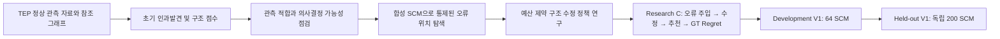

# DAT 제조공정 인과 연구 계보와 팀 인수인계

> 기준: 2026-11-23, 로컬 연구 브랜치 `docs/research-journey-team-handoff-20261123`의 최신 검증 문서. 이 브랜치는 아직 `main`에 병합되지 않았다. 연구 결과는 기존 보고서와 감사 기록을 요약한 것이며, 이 문서 작업에서 새 실험을 실행하지 않았다.

## Part 1. 5분 만에 이해하는 연구

### 우리가 알고 싶은 것

공정에서 조작할 수 있는 변수 하나를 바꾸면 목표 변수에 어떤 결과가 생길까? 그 답을 얻으려면 변수 사이의 인과 구조를 알아야 한다. 예를 들어 냉각수 밸브를 조절했을 때 반응기 온도가 어떻게 바뀌는지 알고 싶다고 하자. 냉각수와 온도가 함께 움직이는지만 보는 것으로는 부족하다. 원료 유량이나 압력이 둘 다에 영향을 주는지, 냉각수 변경이 온도에 직접 또는 다른 변수를 거쳐 영향을 주는지를 구분해야 한다.

**이 냉각수 예시는 개념 설명일 뿐, 이 프로젝트의 실제 TEP 변수나 실험 결과가 아니다.** 실제 연구에서는 공개 Tennessee Eastman Process(TEP) 정상 운전 자료와 참조 구조를 초기에 사용했고, 개입 정답을 통제할 수 있는 합성 SCM 실험으로 연구 초점을 발전시켰다.

인과 그래프는 변수와 방향 화살표의 지도다. `압력 → 온도`는 압력 변화가 온도에 영향을 줄 수 있다는 구조 가설을 나타낸다. 구조방정식 모형(SCM)은 각 변수가 부모 변수와 잡음으로 어떻게 생성되는지를 수식으로 표현한다. 그래프가 달라지면 적합하는 SCM과 조작 추천이 달라질 수 있다.

**구조 정확도와 결정 품질은 별개다.** 전체 그래프 오류가 줄어도 조작에 중요한 경로가 그대로 틀릴 수 있고, 반대로 구조 점수 변화가 작아도 추천 행동이 달라질 수 있다. Decision Regret은 추천 행동의 실제 손실과 같은 후보 중 최선 행동 손실의 차이다. 예측 오차는 관측값을 얼마나 잘 맞췄는지이고, Regret은 선택한 행동이 얼마나 손해였는지이므로 서로 대체할 수 없다.

Research C의 고정 합성 실험에서는 B=2에서 Full Greedy와 무수정 S0를 비교했다. Held-out 200 SCM의 평균 paired delta는 `Regret(S0) − Regret(Full Greedy) = +0.07484`였고, 95% paired-t CI는 `[0.05090, 0.09877]`였다. 45개에서 Greedy Regret이 낮았고 1개에서 높았으며 154개는 같았다. 이는 승인된 합성 SCM 모집단에서의 결과다. 실제 제조공정의 성능이나 정답 그래프를 모르는 현장의 배포 가능성을 증명하지 않는다.

## Part 2. 초기 TEP 연구와 Causal Discovery

### 왜 TEP를 봤나

Tennessee Eastman Process는 공정 변수들이 함께 움직이는 복잡한 화학공정 벤치마크다. 실제 제조공정의 인과 연구를 시작하면서 관측 자료와 공정 구조 참조를 이용해 그래프 발견 방법을 비교하는 출발점으로 선택했다. 저장소에 있는 분석 자료는 `datasetTE.csv`의 1,499행 × 31개 분석 변수다. 원 참조 그래프의 33개 변수에서 X27과 X31을 제외해 분석 변수에 맞춘 31개 노드, 28개 간선을 구조 비교에 사용했다.

이 참조 그래프는 **평가용 구조 참조**다. 완전한 실제 인과 Ground Truth로 검증된 것도, 개입 결과의 정답으로 검증된 것도 아니다. 따라서 F1·SHD는 발견 그래프와 이 참조 표현의 일치도를 설명할 뿐, 실제 개입 효과의 정확도를 직접 말해주지 않는다.

### 어떤 알고리즘과 점수를 사용했나

초기 저장 결과에는 PC-stable, BOSS, DirectLiNGAM, DAGMA, PCMCI+와 시간 지연을 다루는 VarLiNGAM, DYNOTEARS가 포함된다. 정적 알고리즘과 시계열 알고리즘의 출력 의미가 완전히 같지는 않다. 예를 들어 PCMCI+의 동시점 구조에는 식별 문제가 남았고, 시간 지연 그래프는 같은 시점 그래프와 직접 같은 조건으로 순위를 매길 수 없다.

Skeleton F1은 방향을 무시하고 연결 유무를 비교한다. Directed F1은 연결뿐 아니라 화살표 방향도 맞는지 본다. SHD는 삽입·삭제·방향 오류를 그래프 거리로 센다. 저장된 비교표에서 표준 Skeleton F1은 PC-stable 0.360, BOSS 0.328, DirectLiNGAM 0.220, DAGMA 0.267, PCMCI+ 0.321, VarLiNGAM 0.175, DYNOTEARS 0.162였고 Directed F1은 각각 0.080, 0.103, 0.095, 0.064, 0.094, 0.025, 0.029였다. 값은 `docs/audit/step6_main_table.csv` 및 감사 보고서를 기준으로 한다.

이 수치는 **저장된 참조 그래프에 대한 구조 일치도**다. 참조의 누락·방향 불확실성, 알고리즘별 그래프 표현 차이, 시간 지연과 동시점 관계 차이를 해결하지 않는다. 일부 Final 그래프 생성 코드도 회수되지 않아 모든 그래프의 생성 과정을 완전히 재실행할 수 있다고 주장하지 않는다.

근거: [TEP 구조 감사](docs/audit/AUDIT_REPORT.md), [그래프 재현성 인벤토리](docs/reproducibility/GRAPH_REPRODUCIBILITY.json), [구조 점수 표](docs/audit/step6_main_table.csv).

## Part 3. 초기 SCM과 의사결정 문제

그래프는 변수 의존 구조를 나타내므로 SCM 적합의 부모 구조로 쓸 수 있다. 적합한 모형은 관측 자료에서 목표값을 예측하고, 후보 조작별 예상 결과를 계산해 추천을 만들 수 있다. 하지만 관측 예측을 잘하는 것만으로 조작의 인과 효과를 알아냈다고 할 수 없다. 조작은 관측 상관관계와 다른 분포를 만들 수 있고, 관측 자료만으로 그 차이를 식별하지 못할 수도 있다.

초기 TEP 작업의 정상 관측 Ridge/SCM 적합은 관측 예측 진단이다. 이것은 개입 효과, 공정 회복, 안전성의 검증 결과가 아니다. 실제 조작 평가에는 동일 모델·제어기·운전 조건을 맞춘 검증된 개입 환경과 no-action 기준이 필요했지만, 초기 TEP 자료만으로 그런 독립 정답을 만들 수 없었다.

Research C에서는 GT SCM에서 각 행동의 손실을 계산한 뒤 `추천 행동 손실 − 최선 후보 행동 손실`을 Regret으로 정의한다. 예측 오차가 작아도 의사결정 경계 근처에서 행동을 잘못 고르면 손실이 커질 수 있다. 반대로 예측 오차가 있어도 최선 행동과 같은 쪽을 추천하면 Regret은 0일 수 있다.

근거: [정상 관측 적합 요약](experiments/pilot/logs/normal_fit_summary.json), [제조 타당성 Gate 검토](docs/research_design/MANUFACTURING_VALIDITY_GATE_REVIEW.md).

## Part 4. 왜 합성 SCM으로 이동했나

TEP 관측 자료와 저장된 참조 그래프는 구조 발견을 비교하는 데 유용했지만, 연구의 핵심 질문인 “그래프 오류를 고친 뒤 어떤 조작이 실제로 더 나은가?”에 필요한 개입 정답을 제공하지 않았다. 공개 시뮬레이터 후보, Manca 자료, Ricker 및 Python TEP 경로도 같은 버전·모델·제어기·운전 조건을 보장하는 검증된 동일 환경으로 연결되지 않았다. 브리지 검토는 기존 TEP 효과 경로를 중단하는 NO-GO로 정리했다.

합성 SCM은 참 그래프와 구조방정식, 개입 결과를 생성 규칙 안에서 통제할 수 있다. 그래서 특정 오류가 구조 수정과 행동 선택에 미치는 영향을 분리해 확인할 수 있다. 그 대가로 합성 family의 선형식, 제한된 topology·task·행동 후보·손실 가정에 조건부인 결과만 얻는다. 실제 공정의 비선형성, 제어 루프, 안전 제약, 센서·운전 변화, 경제적 비용을 검증하지 않는다.

근거: [통합 제조 벤치마크 검토](docs/research_design/INTEGRATED_MANUFACTURING_BENCHMARK_REVIEW.md), [TEP 환경 브리지 타당성](docs/research_design/TEP_ENVIRONMENT_BRIDGE_FEASIBILITY.md), [TEP 효과·의사결정 타당성](docs/research_design/TEP_EFFECT_DECISION_FEASIBILITY.md).

## Part 5. 오류 위치와 구조 수정의 초기 근거

초기 합성 오류 위치 분석은 같은 총 구조 점수로도 오류가 task 경로에 놓였는지에 따라 추천과 손실이 달라질 수 있음을 보여주는 탐색 자료였다. FN은 참 간선 누락, FP는 참이 아닌 간선 추가, REV는 참 인접성은 남지만 방향이 뒤집힌 경우다. 후속 Research C에서는 미확정 방향 UNRES도 별도 오류 상태로 다룬다.

기존 합성 보고서에는 핵심 경로 누락이 손실을 크게 만든 C07 사례와, 핵심 경로 오류가 항상 더 나쁜 결정으로 이어지지는 않은 C03 반례가 함께 기록돼 있다. 주변 오류도 항상 무해하지 않았다. 이 사례들은 “오류 위치가 중요할 수 있다”는 후속 가설의 근거이지, 한 위치의 오류가 보편적으로 더 해롭다는 법칙은 아니다. path가 유지된다는 사실만으로 효과 추정과 행동이 안전하다고 보장되지 않으며, 경로의 방향·대체 경로·효과 크기·행동 선택 경계가 함께 작용할 수 있다.

근거: [합성 최종 결과와 주장](docs/research_design/SYNTHETIC_FINAL_RESULTS_AND_CLAIMS.md), [Decision Reliability 탐색 보고서](docs/research_design/DECISION_RELIABILITY_NEXT_REPORT.md).

## Part 6. 연구 단계와 방향의 발전

명칭 A/B/C는 연구 계보의 편의상 붙인 단계이며 과거 Step 번호와 일대일 대응한다고 가정하지 않는다. 특히 Step 5/6의 예산 연구는 Research C와 별도 실험 계보로 보존한다.

| 단계 | 질문·자료·방법 | 실제 관찰과 한계 | 왜 다음 단계가 필요했나 |
|---|---|---|---|
| 초기 TEP 구조 발견 | TEP 정상 관측 1,499×31과 31노드·28간선 참조를 사용해 여러 discovery 그래프를 비교 | 알고리즘별 구조 일치도는 계산했지만 참조 완전성 및 개입 효과 정답은 미검증. 일부 Final 생성 코드는 회수되지 않음 | 구조 점수만으로 downstream 조작 성능을 말할 수 없었음 |
| 초기 관측 SCM 진단 | 발견 그래프를 활용한 관측 적합 및 조작 가능성 검토 | 정상 관측 예측 진단이지 독립 개입 효과가 아님 | 실제 개입 정답을 제공할 검증된 TEP 브리지가 없었음 |
| 통제 합성 오류 위치 연구 | 작은 hand-designed 및 rule-generated SCM에서 핵심·주변 오류와 정책 변화를 탐색 | 같은 전체 점수에도 의사결정이 달라지는 사례와 반례를 확인. 작은·제한된 합성 표본 | 더 체계적인 모집단·오류 주입·고정 정책 비교 필요 |
| Step 5/6 예산 연구 | Q-common indirect-only 합성 과제, Task-Focused 대 ID-ordered Global, B=1, 개발/확인 코호트 | 개발 64, 확인 200의 기술 비교. 평균 paired 차이는 각각 약 .01466, .02007. 이는 M1–M4 조합 최적화가 아니며 강한 우월성 주장을 뒷받침하지 않음 | 원래 관심이었던 구조 지표별 우선순위와 수정 예산 배분은 별도로 비교해야 했음 |
| Research C | M1–M4 하위집합 정책, A2 모집단, 여러 예산, 행동 Regret 평가 | Dev 및 독립 Held-out 합성 코호트 완료. 전체 합성 연구 내 재현성 근거를 얻었으나 실제 공정 외부 검증은 없음 | 지금은 추가 정책 확장보다 메커니즘 해석과 현장 타당성의 한계를 정리할 시점 |

Step 5/6 근거: [최종 결과](research/budget_aware_refinement/STEP5_STEP6_FINAL_RESULTS.md), [최종 연구 보고서](research/budget_aware_refinement/FINAL_RESEARCH_REPORT.md), [기존 목적과 최종 연구 감사](ORIGINAL_OBJECTIVE_VS_FINAL_STUDY_AUDIT.md). 해당 숫자를 Research C와 합산하거나 같은 정책 실험으로 표현하지 않는다.

## Part 7. Research C 실험 설계

### 하나의 SCM에서 무엇을 했나

각 독립 SCM마다 참 DAG와 signed linear 구조방정식을 만들고 공통 관측자료를 생성한다. 참 간선 및 비인접 pair를 정해진 확률로 손상해 초기 추정 그래프 G0를 만든다. 여러 수정 정책이 같은 SCM·관측자료·task·행동 후보를 받는다. 각 정책은 예산에 따라 오류를 고치고, 수정 그래프에서 같은 방식으로 SCM을 다시 적합한다. 추천을 확정한 뒤에만 GT evaluator가 행동 손실과 regret을 계산한다.

### 오류·task·지표·정책

- **FN:** 참 adjacency가 G0에 없음. **FP:** 참이 아닌 pair가 G0에 있음. **REV:** 인접성은 있으나 방향이 반대. **UNRES:** 인접성은 있으나 방향 미확정.
- Task zone은 GT DAG상의 모든 X→Y 단순 유향 경로 간선과 무조건화 상태에서 열린 backdoor 경로 간선의 합집합이다. collider가 있는 backdoor 경로는 무조건화 상태에서 제외한다.
- Rule A에서는 FP 양 끝점이 모두 task-zone node set 안에 있으면 task 관련 FP로 태깅한다. 이는 구조적 귀속 규칙이지 실제 개입 손실의 판정이 아니다.
- **M1:** 비과제 참 adjacency에서 FN 비율. **M2:** 비과제 추정 adjacency에서 FP 비율. **M3:** 비과제 참 adjacency의 방향 정확도와 unresolved 비율을 따로 보고하며 정책 proxy는 잔여 REV+UNRES. **M4:** task-zone FN/FP/REV/UNRES 구성요소별 count/support를 보존한다.
- 공식 구조 지표와 정책용 점수는 다르다. Greedy는 선택 지표 subset의 G0 고정 opportunity 분모 잔여오류를 동일 가중 평균한 `P_S`가 원자 수정 하나로 얼마나 줄어드는지를 비용으로 나눠 매 단계 다시 계산한다. M4에서는 활성 오류 성분을 동일 가중한다. 이는 근시안적 구조 대리목적이며 Regret을 직접 최적화하지 않는다.
- S0는 무수정, 15개 정책은 M1–M4의 모든 비공집합 조합, Full Greedy는 M1+M2+M3+M4다. Canonical Oracle은 GT 구조정보를 쓰는 고정 순서의 **structural-only 진단 기준선**이다. GT SCM 손실이나 최선 행동을 보지 않으며, regret 최적 oracle이나 이론적 상한이 아니다.
- 허용된 원자 수정은 FN add, FP delete, REV orient, UNRES resolve이며 단위 비용 1, 예산 B=0–4다. residual UNRES는 구조 그래프에 남기고 학습용 DAG에서는 부모·자식 관계로 쓰지 않는 abstention 처리다. 그 변환은 유료 복구가 아니다.
- 17개 정책( S0 + 15 조합 + Canonical Oracle ) × 예산 5개는 같은 입력에 적용된다. 같은 최종 그래프 또는 행동을 만든 정책이 있어도 별도 결과로 모두 보존한다.

### Oracle 정보 경계와 P1

정책은 관측자료와 G0를 사용하고, 승인된 Oracle-assisted 구조 수정은 GT DAG를 오류 확인·후보 방향·task zone에 사용한다. 이는 실제 환경에서 GT 그래프를 모르는 채 사용할 수 있는 알고리즘이 아니다. 어떤 정책도 추천 전에 GT SCM의 행동별 실제 손실·최적 행동·Regret을 사용하지 않는다. GT 평가는 추천 확정 뒤에 수행된다.

승인된 P1은 B=2의 Full Greedy 대 S0이며 SCM 단위 `delta = Regret(S0) − Regret(Full Greedy)`다. 양수는 Full Greedy 쪽 Regret이 낮다는 뜻이다. M4 대 Full Greedy는 Development 결과를 본 뒤 선택된 Held-out Secondary이지 원래 Primary가 아니다.

근거: [승인 결정 브리프](RESEARCH_C_APPROVAL_DECISION_BRIEF.md), [실험 계약 V1](RESEARCH_C_EXPERIMENT_CONTRACT_V1.md), [Held-out 분석 잠금](RESEARCH_C_HELDOUT_ANALYSIS_LOCK.md), [정책 엔진](research/original_objective/policy_engine.py), [Research C 코드 안내](research/original_objective/README.md).

## Part 8. Development와 Held-out 결과

원시 SQLite와 감사 JSON은 저장소 밖의 승인된 `C:\DAT_RESEARCH\research-c\...`에 있다. 아래 수치는 커밋된 [Held-out 결과·감사 보고서](RESEARCH_C_HELDOUT_V1_RESULTS.md)와 관련 Development 감사 문서를 기준으로 한다. 원본 ledger는 손대지 않는다.

| 항목 | Development V1 | Held-out V1 |
|---|---:|---:|
| Admitted / complete P1 SCM | 64 / 64 | 200 / 200 |
| 정책×예산 평가 | 5,440 | 17,000 |
| Primary 평균 delta | +0.07521 | +0.07484 |
| 95% paired-t CI | [0.03223, 0.11819] | [0.05090, 0.09877] |
| Held-out SCM bootstrap 95% CI | — | [0.05225, 0.09972] |
| P1 개선 / 악화 / 동률 | 14 / 1 / 49 | 45 / 1 / 154 |
| 평균 S0 Regret | 0.10085 | 0.09344 |
| 평균 Full Greedy Regret | 0.02564 | 0.01860 |
| 평균 M4 Regret | 0.00293 | 0.00399 |

Held-out에는 Proposal 202, 적격·admitted 200, 무오류 G0 34, 평가 실패·자원 초과·shortfall 0이었다. 154개 동률은 모두 추천 행동이 같았다. 그중 34개는 무오류 G0 및 Full Greedy no-op과 같은 집합이었고, 나머지 120개는 그래프는 달라도 추천 행동이 같았다.

Full Greedy의 P1 개선은 이 합성 모집단에서 평균적으로 B=2 구조 수정을 허용한 정책이 무수정 S0보다 낮은 regret을 보였다는 뜻이다. 독립 Held-out에서 유사한 평균 차이가 관측된 것은 같은 승인된 생성·평가 절차 안에서 반복된 근거라는 점에서 의미가 있지만, 서로 다른 제조공장·공정 분포의 외부 타당성을 보장하지 않는다.

M4 평균 Regret은 Held-out에서 Full Greedy보다 낮았지만 이는 Development 결과 확인 후 지정한 Secondary다. 선택 후 비교와 15개 조합의 탐색은 다중 비교·선택 편향에 노출되며, 일반적인 M4 우월성 증거가 아니다. 154개 동률도 실패가 아니라 해당 SCM에서 수정이 행동을 바꾸지 않았거나, 행동의 GT 손실이 같았음을 뜻할 수 있다. 구조 개선만으로 행동 개선을 가정할 수 없다.

근거: [Held-out 전체 결과](RESEARCH_C_HELDOUT_V1_RESULTS.md), [Development 감사](RESEARCH_C_DEVELOPMENT_V1_AUDIT.md), [Development provenance 정정](RESEARCH_C_DEVELOPMENT_V1_PROVENANCE_CORRECTION.md).

## Part 9. 무엇을 주장할 수 있고 없는가

**확인된 범위:** 승인된 합성 SCM 생성·task·G0·수정·평가 조건에서 Full Greedy 대 S0의 P1 평균 paired regret 차이는 Development와 Held-out에서 모두 양수였다. 구조 변화, 행동 변화, Regret 변화는 각각 구분해 기록됐다.

**보조 발견:** M4는 관측 평균 Regret이 낮았으나 Development 후 선택된 Secondary다. 메커니즘 설명은 실제 수정 이력과 사례를 대조해야 한다.

**연구 의미:** 전체 구조 점수만이 아니라 오류의 위치, 선택한 구조 수정 정책, 예산, downstream 행동을 함께 평가할 이유가 있다.

**한계:** 합성 signed-linear SCM, 네 topology template와 제한된 task/action/loss, GT DAG 기반 Oracle-assisted repair, 고정된 관측표본·오차 생성, 실제 TEP 개입 및 제조공정 외부 검증 부재. 본 결과는 실제 제조공정의 회복·수율·안전성이나 현장 배포를 입증하지 않는다. 초기 TEP 참조 그래프도 완전한 인과 GT로 검증되지 않았다.

## Part 10. 팀원 역할과 실행 가능한 업무

| 담당 | 책임 | 이번 주 범위 |
|---|---|---|
| 오성민 | 연구 총괄, A/B/C와 초기 연구의 최종 통합, 결과·발표 검토, PR/병합 의사결정 | 인수인계 확인, 정창민 분석 검토, 통합 보고 준비 |
| 정창민 | M1–M4 구조 지표와 repair policy가 실제 수정·행동·Regret에 미친 메커니즘 분석 | 아래 독립 분석 workflow 수행. 새 실험·정책 변경 없음 |
| 황주희 | 이번 주 발표 준비 우선 | 이번 주 필수 연구 과업 없음. 발표 후 선택적으로 가독성 피드백과 예상 질문 제안 |

### 정창민의 순서와 완료 기준

1. `research/original_objective/policy_engine.py`, 승인 결정 브리프, 실험 계약을 읽고 metric의 공식 분자·분모와 Greedy용 `P_S`를 구분한다. 정의 불일치는 해석 전에 기록한다. **산출물:** `M1_M4_METRIC_DEFINITION_REVIEW.md`.
2. Development와 Held-out 결과를 읽기 전용으로 확인하고 정책별 수정 기회, 실제 edit type, 순서, 비용, graph hash, 추천 행동, regret을 SCM ID에 연결한다. 정책 평가 행을 독립 표본으로 세지 않는다. **산출물:** 정책별 수정 유형·비용·평균 Regret 표.
3. M4와 Full Greedy가 다른 그래프를 만든 SCM을 찾고 오류 유형·task/off-task 위치·예산 사용과 추천/손실을 대조한다. M4가 악화된 경우도 반례로 보존한다. 비과제 오류에 예산을 써서 중요한 오류를 놓쳤다는 설명은 로그가 직접 뒷받침할 때만 쓴다.
4. 실제 SCM ID가 포함된 대표 사례 3–5개와 수정 순서·최종 행동 연결 그림 2–3개를 작성한다. 동일 graph/action/regret을 별개 결과로 혼동하지 않는다. 원인을 확인할 수 없는 사례는 가설 또는 미해결로 표시한다.
5. 최종 `CHANGMIN_METRIC_POLICY_ANALYSIS.md`에 확인된 사실, 예외, Oracle-assisted 한계, Development와 Held-out의 구분, 사후 탐색 성격을 기록한다.

**데이터 안전:** `C:\DAT_RESEARCH\research-c\development\...`와 `...\heldout\...` 원본은 현재 실행환경의 로컬 저장소 밖에 있다. 권한이 부여된 원본 경로에서 read-only SQLite/query-only로 접근하고, 수정 코드를 쓰거나 기존 ledger를 갱신하지 않는다. 팀원이 경로에 접근할 수 있는지 별도로 확인해야 한다. 분석 스크립트가 필요하면 독립 파일·개인 브랜치에서 만들고, 입력 hash와 실행 명령을 기록한다. Held-out을 본 뒤 하는 메커니즘 분석은 사후 탐색 분석이다.

이상 징후가 있으면 원본 checksum/manifest부터 확인한다. 정책 비용 차이는 원자 edit 로그와 비교한다. 동일 그래프여도 추천·Regret을 따로 본다. 많은 동률은 행동 동일 여부와 최적 행동 경계를 확인한다. 원인을 확정할 수 없는 것은 미해결로 남긴다. 승인 코드·Manifest를 바꾸거나 새로운 코호트를 만들지 않는다.

### 황주희의 선택 업무

발표 이후 문서 중 이해하기 어려운 설명 표시, 연구 질문과 결과 연결에 대한 피드백, 비전공자 관점의 예상 질문 3–5개 제안이 가능하다. 이번 주에는 별도 코딩·시뮬레이터·연구 과제를 부여하지 않는다.

## Part 11. 저장소와 GitHub 인수인계

### 새 팀원이 읽을 순서

1. `README.md` — 현재 로컬 연구 브랜치 상태와 시작 링크.
2. 이 문서 — 연구 질문이 바뀐 이유와 실험 계보.
3. `RESEARCH_C_APPROVAL_DECISION_BRIEF.md` 및 `RESEARCH_C_EXPERIMENT_CONTRACT_V1.md` — 승인된 계약.
4. `RESEARCH_C_HELDOUT_ANALYSIS_LOCK.md`, `RESEARCH_C_HELDOUT_V1_RESULTS.md` — 분석 잠금과 최종 결과.
5. `RESEARCH_C_DEVELOPMENT_V1_AUDIT.md`, provenance correction — Dev 감사.
6. `research/original_objective/README.md`, `policy_engine.py` — 구현 설명 및 metric/policy.
7. TEP 구조 감사 및 합성 결과 문서 — 초기 연구와 전환 근거.

### 저장소 지도

- 최초 구조 발견·감사: `graphs/final/`, `docs/audit/`, `docs/reproducibility/`.
- TEP·제조공정 타당성 검토: `docs/research_design/` 및 `experiments/pilot/`.
- 이전 예산 연구: `research/budget_aware_refinement/`.
- Research C 실행·정책·테스트: `research/original_objective/`, `scripts/run_research_c_runner.py`, `tests/`.
- Research C 계약·감사·결과: 저장소 루트의 `RESEARCH_C_*.md`.
- 로컬 외부 원본: `C:\DAT_RESEARCH\research-c\...`; 저장소 밖이므로 팀원이 자동으로 볼 수 없으며 GitHub에 복사하지 않는다. 접근과 공유 권한은 별도 확인한다.
- 자료 출처·권리·재현 지침: `data/README.md`, `docs/reproducibility/TEAM_GUIDE.md`.

### 협업 원칙

먼저 현재 작업 브랜치와 README의 source branch를 확인한다. 개인 작업은 별도 브랜치에서 하고, 목적과 변경 범위가 분명한 PR로 검토한다. 결과·원본을 읽기 전용으로 다루며, 문제 신고 시 SCM ID, proposal ID, source/config/manifest 식별자, 파일 checksum, 재현 명령, 기대/실제 차이 및 단계별 실패 사유를 제공한다. 원격 main 직접 수정, 동결 자료 덮어쓰기, 외부 원시 데이터 업로드는 하지 않는다.

2026-11-23 조사 시 이 문서 브랜치는 로컬에서 `origin/main`보다 41개 커밋 앞서 있었고, 117개 파일 규모의 변경이 main 대비 포함됐다. 이는 문서만의 diff가 아니다. 따라서 이 작업에서는 넓은 연구 이력을 포함한 원격 Push를 보류한다. 문서는 현재 로컬 브랜치에서 검토 가능하며, GitHub 공개 범위는 사용자가 PR base/head와 기존 의존성 범위를 확인한 뒤 결정해야 한다. 기존 PR #38은 병합되었고, #34/#35는 별개의 TEP 작업이므로 이 작업에서 수정하지 않았다.

## 주요 근거 문서

- [연구 진화 기록](RESEARCH_EVOLUTION.md) · [원래 연구 설계](RESEARCH_DESIGN.md)
- [TEP 구조 감사](docs/audit/AUDIT_REPORT.md) · [그래프 재현성 기록](docs/reproducibility/GRAPH_REPRODUCIBILITY.json)
- [초기 합성 결과](docs/research_design/SYNTHETIC_FINAL_RESULTS_AND_CLAIMS.md) · [TEP 브리지 검토](docs/research_design/TEP_ENVIRONMENT_BRIDGE_FEASIBILITY.md)
- [Step 5/6 결과](research/budget_aware_refinement/STEP5_STEP6_FINAL_RESULTS.md) · [Research C 계약](RESEARCH_C_EXPERIMENT_CONTRACT_V1.md)
- [Research C 승인 브리프](RESEARCH_C_APPROVAL_DECISION_BRIEF.md) · [Held-out 분석 잠금](RESEARCH_C_HELDOUT_ANALYSIS_LOCK.md) · [Held-out 결과](RESEARCH_C_HELDOUT_V1_RESULTS.md)
