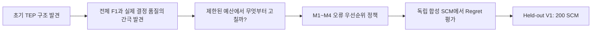

# DAT 제조공정 — 예산 제약 인과그래프 오류 수정 연구와 팀 인수인계

> 최신 연구 통합(2026-11-28): 기존 아래 역사적 시점 서술은 보존한다. 현재의 연구 질문·Research 0–4 연결·검증된 결과와 최종보고서/발표 구성은 저장소 root의 [FINAL_RESEARCH_FRAMEWORK.md](FINAL_RESEARCH_FRAMEWORK.md), [FINAL_RESEARCH_EVIDENCE_MATRIX.md](FINAL_RESEARCH_EVIDENCE_MATRIX.md), [FINAL_RESEARCH_TEAM_GUIDE.md](FINAL_RESEARCH_TEAM_GUIDE.md)를 기준으로 한다. S4/S5 및 Research E extension의 cohort와 evidence grade를 합산하지 않는다. S4/S5 새 예산 분석은 저장된 B=0–4만 재집계했고 B=5–9 replay는 실행하지 않았다. S6 v6는 저장 S4 candidate records의 사후 B=1 비교이며 T5 우월성은 확립되지 않았다. S7은 0/400 G0·0/24,000 recommendations, evaluator 미실행으로 닫혔다. 최종 저장소 inventory와 보존 한계는 [Repository final closeout](REPOSITORY_FINAL_CLOSEOUT.md) 및 [archive index](archive/ARCHIVE_INDEX.md)를 참조한다.

> 역사적 본문 기준: 2026-11-23의 로컬 연구 브랜치 `docs/research-journey-team-handoff-20261123`. 당시의 상태 표현은 해당 날짜의 기록이며 현재 main 상태를 뜻하지 않는다. 2026-11-26 최종 인수인계는 Part 8에 추가했다. 이 통합에서 새 실험은 실행하지 않았다.

## Part 1. 5분 만에 이해하는 연구

### 최종 연구 질문: 주어진 예산에서 무엇부터 고쳐야 하는가?

**현재 우리의 연구 질문은 ‘수정할 수 있는 간선 오류가 제한되어 있을 때, 어떤 오류를 먼저 고쳐야 의사결정 손실(Decision Regret)을 가장 줄일 수 있는가?’이다.** 모든 인과그래프 오류를 완벽하게 복구하려는 연구가 아니다.

공정에서 조작할 수 있는 변수 하나를 바꾸면 목표 변수에 어떤 결과가 생길까? 그 답을 얻으려면 변수 사이의 인과 구조를 알아야 한다. 예를 들어 냉각수 밸브를 조절했을 때 반응기 온도가 어떻게 바뀌는지 알고 싶다고 하자. 냉각수와 온도가 함께 움직이는지만 보는 것으로는 부족하다. 원료 유량이나 압력이 둘 다에 영향을 주는지, 냉각수 변경이 온도에 직접 또는 다른 변수를 거쳐 영향을 주는지를 구분해야 한다.

**이 냉각수 예시는 개념 설명일 뿐, 이 프로젝트의 실제 TEP 변수나 실험 결과가 아니다.** 실제 연구에서는 공개 Tennessee Eastman Process(TEP) 정상 운전 자료와 참조 구조를 초기에 사용했고, 개입 정답을 통제할 수 있는 합성 SCM 실험으로 연구 초점을 발전시켰다.

인과 그래프는 변수와 방향 화살표의 지도다. `압력 → 온도`는 압력 변화가 온도에 영향을 줄 수 있다는 구조 가설을 나타낸다. 구조방정식 모형(SCM)은 각 변수가 부모 변수와 잡음으로 어떻게 생성되는지를 수식으로 표현한다. 그래프가 달라지면 적합하는 SCM과 조작 추천이 달라질 수 있다.

**구조 정확도와 결정 품질은 별개다.** 전체 그래프 오류가 줄어도 조작에 중요한 경로가 그대로 틀릴 수 있고, 반대로 구조 점수 변화가 작아도 추천 행동이 달라질 수 있다. Decision Regret은 추천 행동의 실제 손실과 같은 후보 중 최선 행동 손실의 차이다. 예측 오차는 관측값을 얼마나 잘 맞췄는지이고, Regret은 선택한 행동이 얼마나 손해였는지이므로 서로 대체할 수 없다.

Research C의 고정 합성 실험에서는 B=2에서 Full Greedy와 무수정 S0를 비교했다. Held-out 200 SCM의 평균 paired delta는 `Regret(S0) − Regret(Full Greedy) = +0.07484`였고, 95% paired-t CI는 `[0.05090, 0.09877]`였다. 45개에서 Greedy Regret이 낮았고 1개에서 높았으며 154개는 같았다. 이는 승인된 합성 SCM 모집단에서의 결과다. 실제 제조공정의 성능이나 정답 그래프를 모르는 현장의 배포 가능성을 증명하지 않는다.

## Part 2. 과거 연구는 왜 현재 질문으로 이어졌나?

초기에는 TEP 정상 운전 관측자료(1,499행 × 31개 변수)에서 PC-stable, BOSS, DirectLiNGAM 등을 포함한 Causal Discovery 방법으로 인과그래프를 추정하고, 28간선의 참고 구조와 F1·SHD 일치도를 비교했다. 하지만 **TEP 참고 그래프는 완전한 인과 Ground Truth로 검증되지 않았고**, 관측값 예측이 실제 개입 효과의 정확성을 뜻하지 않았다.

한편 관측자료와 공개 시뮬레이터의 모델·제어기·기록 시계가 충분히 정합하다고 검증되지 않아 실제 TEP 조작 손실을 독립적으로 평가할 수 없었다. 따라서 정답 구조와 조작 결과를 통제하는 **합성 SCM**으로 전환했다. 초기 합성 실험에서는 전체 구조 점수가 같거나 비슷해도 오류가 조작 관련 경로에 있는지에 따라 추천 행동·손실이 달라지는 사례와 반례가 나왔다. **이것이 ‘그래프의 모든 오류를 동일하게 고칠 필요가 있는가?’라는 현재 연구 질문의 출발점**이다.

과거 Step 5/6은 별도의 예산·과제 설계를 평가한 연구이며, 현재 Research C의 M1~M4 조합 실험과 같은 코호트가 아니다. 초기 실패·중단·기술 Gate는 역사 기록에 보존하고 이 인수인계 문서에서는 필요한 배경만 설명한다.

근거: [초기 구조 평가](docs/audit/AUDIT_REPORT.md), [초기 합성 결과 및 한계](docs/research_design/SYNTHETIC_FINAL_RESULTS_AND_CLAIMS.md), [TEP 브리지 타당성](docs/research_design/TEP_ENVIRONMENT_BRIDGE_FEASIBILITY.md), [별도 Step 5/6 결과](research/budget_aware_refinement/STEP5_STEP6_FINAL_RESULTS.md).

## Part 3. 최종 Research C: 어떤 오류를 먼저 수정하는가?

### 예산이 2라면 어떤 오류 두 개를 고쳐야 할까?

*설명용 가상 예시:* 조작변수 X와 목표변수 Y를 잇는 핵심 경로의 누락(FN), 과제와 무관한 주변의 가짜 연결(FP), 그리고 과제 관련 방향 오류(REV)가 하나씩 있다고 가정하자. 오류를 모두 고칠 수 없다면 전체 그래프의 오류 개수보다는 **수정한 뒤 어떤 조작을 추천하고 그 행동의 손실이 어떻게 달라지는지**를 물어야 한다. 실제 정책은 ‘손실의 정답’을 미리 보지 않고 구조적 대리 점수와 단위 수정 비용에 따라 선택한다. 이 예시는 실험에 사용한 특정 SCM 사례가 아니다.

### 하나의 SCM에서 무엇을 했나

각 독립 SCM마다 참 DAG와 signed linear 구조방정식을 만들고 공통 관측자료를 생성한다. 참 간선 및 비인접 pair를 정해진 확률로 손상해 초기 추정 그래프 G0를 만든다. 여러 수정 정책이 같은 SCM·관측자료·task·행동 후보를 받는다. 각 정책은 예산에 따라 오류를 고치고, 수정 그래프에서 같은 방식으로 SCM을 다시 적합한다. 추천을 확정한 뒤에만 GT evaluator가 행동 손실과 regret을 계산한다.

### 오류·task·지표·정책

- **FN:** 참 adjacency가 G0에 없음. **FP:** 참이 아닌 pair가 G0에 있음. **REV:** 인접성은 있으나 방향이 반대. **UNRES:** 인접성은 있으나 방향 미확정.
- Task zone은 GT DAG상의 모든 X→Y 단순 유향 경로 간선과 무조건화 상태에서 열린 backdoor 경로 간선의 합집합이다. collider가 있는 backdoor 경로는 무조건화 상태에서 제외한다.
- Rule A에서는 FP 양 끝점이 모두 task-zone node set 안에 있으면 task 관련 FP로 태깅한다. 이는 구조적 귀속 규칙이지 실제 개입 손실의 판정이 아니다.
- **M1:** 비과제 참 adjacency에서 FN 비율. **M2:** 비과제 추정 adjacency에서 FP 비율. **M3:** 비과제 참 adjacency의 방향 정확도와 unresolved 비율을 따로 보고하며 정책 proxy는 잔여 REV+UNRES. **M4:** task-zone FN/FP/REV/UNRES 구성요소별 count/support를 보존한다.
- 공식 구조 지표와 정책용 점수는 다르다. Greedy는 선택 지표 subset의 G0 고정 opportunity 분모 잔여오류를 동일 가중 평균한 `P_S`가 원자 수정 하나로 얼마나 줄어드는지를 비용으로 나눠 매 단계 다시 계산한다. M4에서는 활성 오류 성분을 동일 가중한다. 이는 근시안적 구조 대리목적이며 Regret을 직접 최적화하지 않는다.
- S0는 무수정, 15개 정책은 M1–M4의 모든 비공집합 조합, Full Greedy는 M1+M2+M3+M4다. Canonical Oracle은 GT 구조정보를 쓰는 고정 순서의 **structural-only 진단 기준선**이다. GT SCM 손실이나 최선 행동을 보지 않으며, regret 최적 oracle이나 이론적 상한이 아니다.
- 허용된 원자 수정은 FN add, FP delete, REV orient, UNRES resolve이며 단위 비용 1, 예산 B=0–4다. residual UNRES는 구조 그래프에 남기고 학습용 DAG에서는 부모·자식 관계로 쓰지 않는 abstention 처리다. 그 변환은 유료 복구가 아니다.
- 17개 정책( S0 + 15 조합 + Canonical Oracle ) × 예산 5개는 같은 입력에 적용된다. 같은 최종 그래프 또는 행동을 만든 정책이 있어도 별도 결과로 모두 보존한다.

### Oracle 정보 경계와 P1

정책은 관측자료와 G0를 사용하고, 승인된 Oracle-assisted 구조 수정은 GT DAG를 오류 확인·후보 방향·task zone에 사용한다. 이는 실제 환경에서 GT 그래프를 모르는 채 사용할 수 있는 알고리즘이 아니다. 어떤 정책도 추천 전에 GT SCM의 행동별 실제 손실·최적 행동·Regret을 사용하지 않는다. GT 평가는 추천 확정 뒤에 수행된다.

승인된 P1은 B=2의 Full Greedy 대 S0이며 SCM 단위 `delta = Regret(S0) − Regret(Full Greedy)`다. 양수는 Full Greedy 쪽 Regret이 낮다는 뜻이다. M4 대 Full Greedy는 Development 결과를 본 뒤 선택된 Held-out Secondary이지 원래 Primary가 아니다.

근거: [승인 결정 브리프](RESEARCH_C_APPROVAL_DECISION_BRIEF.md), [실험 계약 V1](RESEARCH_C_EXPERIMENT_CONTRACT_V1.md), [Held-out 분석 잠금](RESEARCH_C_HELDOUT_ANALYSIS_LOCK.md), [정책 엔진](research/original_objective/policy_engine.py), [Research C 코드 안내](research/original_objective/README.md).

## Part 4. 독립 Held-out으로 확인한 결과

원시 SQLite와 감사 JSON은 저장소 밖의 승인된 `C:\DAT_RESEARCH\research-c\...`에 있다. 아래 수치는 커밋된 [Held-out 결과·감사 보고서](RESEARCH_C_HELDOUT_V1_RESULTS.md)와 관련 Development 감사 문서를 기준으로 한다. 원본 ledger는 손대지 않는다.

| 항목 | Development V1 | Held-out V1 |
|---|---:|---:|
| Admitted / complete P1 SCM | 64 / 64 | 200 / 200 |
| 정책×예산 평가 | 5,440 | 17,000 |
| Primary 평균 delta | +0.07521 | +0.07484 |
| 95% paired-t CI | [0.03223, 0.11819] | [0.05090, 0.09877] |
| Held-out SCM bootstrap 95% CI | — | [0.05225, 0.09972] |
| P1 개선 / 악화 / 동률 | 14 / 1 / 49 | 45 / 1 / 154 |
| 평균 S0 Regret | 0.10085 | 0.09344 |
| 평균 Full Greedy Regret | 0.02564 | 0.01860 |
| 평균 M4 Regret | 0.00293 | 0.00399 |

Held-out에는 Proposal 202, 적격·admitted 200, 무오류 G0 34, 평가 실패·자원 초과·shortfall 0이었다. 154개 동률은 모두 추천 행동이 같았다. 그중 34개는 무오류 G0 및 Full Greedy no-op과 같은 집합이었고, 나머지 120개는 그래프는 달라도 추천 행동이 같았다.

Full Greedy의 P1 개선은 이 합성 모집단에서 평균적으로 B=2 구조 수정을 허용한 정책이 무수정 S0보다 낮은 regret을 보였다는 뜻이다. 독립 Held-out에서 유사한 평균 차이가 관측된 것은 같은 승인된 생성·평가 절차 안에서 반복된 근거라는 점에서 의미가 있지만, 서로 다른 제조공장·공정 분포의 외부 타당성을 보장하지 않는다.

M4 평균 Regret은 Held-out에서 Full Greedy보다 낮았지만 이는 Development 결과 확인 후 지정한 Secondary다. 선택 후 비교와 15개 조합의 탐색은 다중 비교·선택 편향에 노출되며, 일반적인 M4 우월성 증거가 아니다. 154개 동률도 실패가 아니라 해당 SCM에서 수정이 행동을 바꾸지 않았거나, 행동의 GT 손실이 같았음을 뜻할 수 있다. 구조 개선만으로 행동 개선을 가정할 수 없다.

근거: [Held-out 전체 결과](RESEARCH_C_HELDOUT_V1_RESULTS.md), [Development 감사](RESEARCH_C_DEVELOPMENT_V1_AUDIT.md), [Development provenance 정정](RESEARCH_C_DEVELOPMENT_V1_PROVENANCE_CORRECTION.md).

## Part 5. 최종 결론과 주장할 수 없는 것

**확인된 범위:** 승인된 합성 SCM 생성·task·G0·수정·평가 조건에서 Full Greedy 대 S0의 P1 평균 paired regret 차이는 Development와 Held-out에서 모두 양수였다. 구조 변화, 행동 변화, Regret 변화는 각각 구분해 기록됐다.

**보조 발견:** M4는 관측 평균 Regret이 낮았으나 Development 후 선택된 Secondary다. 메커니즘 설명은 실제 수정 이력과 사례를 대조해야 한다.

**연구 의미:** 전체 구조 점수만이 아니라 오류의 위치, 선택한 구조 수정 정책, 예산, downstream 행동을 함께 평가할 이유가 있다.

**한계:** 합성 signed-linear SCM, 네 topology template와 제한된 task/action/loss, GT DAG 기반 Oracle-assisted repair, 고정된 관측표본·오차 생성, 실제 TEP 개입 및 제조공정 외부 검증 부재. 본 결과는 실제 제조공정의 회복·수율·안전성이나 현장 배포를 입증하지 않는다. 초기 TEP 참조 그래프도 완전한 인과 GT로 검증되지 않았다.

## Part 6. 팀원 역할과 실행 가능한 업무

| 담당 | 책임 | 이번 주 범위 |
|---|---|---|
| 오성민 | 연구 총괄, A/B/C와 초기 연구의 최종 통합, 결과·발표 검토, PR/병합 의사결정 | 인수인계 확인, 정창민 분석 검토, 통합 보고 준비 |
| 정창민 | M1–M4 구조 지표와 repair policy가 실제 수정·행동·Regret에 미친 메커니즘 분석 | 아래 독립 분석 workflow 수행. 새 실험·정책 변경 없음 |
| 황주희 | 이번 주 발표 준비 우선 | 이번 주 필수 연구 과업 없음. 발표 후 선택적으로 가독성 피드백과 예상 질문 제안 |

### 정창민의 순서와 완료 기준

1. `research/original_objective/policy_engine.py`, 승인 결정 브리프, 실험 계약을 읽고 metric의 공식 분자·분모와 Greedy용 `P_S`를 구분한다. 정의 불일치는 해석 전에 기록한다. **산출물:** `M1_M4_METRIC_DEFINITION_REVIEW.md`.
2. Development와 Held-out 결과를 읽기 전용으로 확인하고 정책별 수정 기회, 실제 edit type, 순서, 비용, graph hash, 추천 행동, regret을 SCM ID에 연결한다. 정책 평가 행을 독립 표본으로 세지 않는다. **산출물:** 정책별 수정 유형·비용·평균 Regret 표.
3. M4와 Full Greedy가 다른 그래프를 만든 SCM을 찾고 오류 유형·task/off-task 위치·예산 사용과 추천/손실을 대조한다. M4가 악화된 경우도 반례로 보존한다. 비과제 오류에 예산을 써서 중요한 오류를 놓쳤다는 설명은 로그가 직접 뒷받침할 때만 쓴다.
4. 실제 SCM ID가 포함된 대표 사례 3–5개와 수정 순서·최종 행동 연결 그림 2–3개를 작성한다. 동일 graph/action/regret을 별개 결과로 혼동하지 않는다. 원인을 확인할 수 없는 사례는 가설 또는 미해결로 표시한다.
5. 최종 `CHANGMIN_METRIC_POLICY_ANALYSIS.md`에 확인된 사실, 예외, Oracle-assisted 한계, Development와 Held-out의 구분, 사후 탐색 성격을 기록한다.

**데이터 안전:** `C:\DAT_RESEARCH\research-c\development\...`와 `...\heldout\...` 원본은 현재 실행환경의 로컬 저장소 밖에 있다. 권한이 부여된 원본 경로에서 read-only SQLite/query-only로 접근하고, 수정 코드를 쓰거나 기존 ledger를 갱신하지 않는다. 팀원이 경로에 접근할 수 있는지 별도로 확인해야 한다. 분석 스크립트가 필요하면 독립 파일·개인 브랜치에서 만들고, 입력 hash와 실행 명령을 기록한다. Held-out을 본 뒤 하는 메커니즘 분석은 사후 탐색 분석이다.

이상 징후가 있으면 원본 checksum/manifest부터 확인한다. 정책 비용 차이는 원자 edit 로그와 비교한다. 동일 그래프여도 추천·Regret을 따로 본다. 많은 동률은 행동 동일 여부와 최적 행동 경계를 확인한다. 원인을 확정할 수 없는 것은 미해결로 남긴다. 승인 코드·Manifest를 바꾸거나 새로운 코호트를 만들지 않는다.

### 황주희의 선택 업무

발표 이후 문서 중 이해하기 어려운 설명 표시, 연구 질문과 결과 연결에 대한 피드백, 비전공자 관점의 예상 질문 3–5개 제안이 가능하다. 이번 주에는 별도 코딩·시뮬레이터·연구 과제를 부여하지 않는다.

## Part 7. 저장소와 GitHub 인수인계

### 새 팀원이 읽을 순서

1. `README.md` — 현재 연구 브랜치의 시작 링크.
2. 이 문서 — 연구 질문이 바뀐 이유와 실험 계보.
3. `RESEARCH_C_APPROVAL_DECISION_BRIEF.md` 및 `RESEARCH_C_EXPERIMENT_CONTRACT_V1.md` — 승인된 계약.
4. `RESEARCH_C_HELDOUT_ANALYSIS_LOCK.md`, `RESEARCH_C_HELDOUT_V1_RESULTS.md` — 분석 잠금과 최종 결과.
5. `RESEARCH_C_DEVELOPMENT_V1_AUDIT.md`, provenance correction — Dev 감사.
6. `research/original_objective/README.md`, `policy_engine.py` — 구현 설명 및 metric/policy.
7. TEP 구조 감사 및 합성 결과 문서 — 초기 연구와 전환 근거.

### 저장소 지도

- 최초 구조 발견·감사: `graphs/final/`, `docs/audit/`, `docs/reproducibility/`.
- TEP·제조공정 타당성 검토: `docs/research_design/` 및 `experiments/pilot/`.
- 이전 예산 연구: `research/budget_aware_refinement/`.
- Research C 실행·정책·테스트: `research/original_objective/`, `scripts/run_research_c_runner.py`, `tests/`.
- Research C 계약·감사·결과: 저장소 루트의 `RESEARCH_C_*.md`.
- 로컬 외부 원본: `C:\DAT_RESEARCH\research-c\...`; 저장소 밖이므로 팀원이 자동으로 볼 수 없으며 GitHub에 복사하지 않는다. 접근과 공유 권한은 별도 확인한다.
- 운영 상태는 `docs/research_state_current.json`; `docs/research_state.json`은 과거 Step 4 동결 해시가 걸린 스냅샷으로 편집 금지.
- 자료 출처·권리·재현 지침: `data/README.md`, `docs/reproducibility/TEAM_GUIDE.md`.

### 협업 원칙

먼저 현재 작업 브랜치와 README의 source branch를 확인한다. 개인 작업은 별도 브랜치에서 하고, 목적과 변경 범위가 분명한 PR로 검토한다. 결과·원본을 읽기 전용으로 다루며, 문제 신고 시 SCM ID, proposal ID, source/config/manifest 식별자, 파일 checksum, 재현 명령, 기대/실제 차이 및 단계별 실패 사유를 제공한다. 원격 main 직접 수정, 동결 자료 덮어쓰기, 외부 원시 데이터 업로드는 하지 않는다.

역사적으로 이 문서는 2026-11-23 시점에 Research C가 main에 아직 병합되지 않았다고 기록했다. 이후 PR #39가 main에 병합되었다. 2026-11-26 최종 통합에서 PR #40 메커니즘 분석과 Research D를 통합 브랜치로 정리한다. 본 문서의 시점별 이력은 보존하며 최종 통합 PR의 현재 상태는 실제 GitHub 기록을 따른다.

## 주요 근거 문서

- [연구 진화 기록](RESEARCH_EVOLUTION.md) · [원래 연구 설계](RESEARCH_DESIGN.md)
- [TEP 구조 감사](docs/audit/AUDIT_REPORT.md) · [그래프 재현성 기록](docs/reproducibility/GRAPH_REPRODUCIBILITY.json)
- [초기 합성 결과](docs/research_design/SYNTHETIC_FINAL_RESULTS_AND_CLAIMS.md) · [TEP 브리지 검토](docs/research_design/TEP_ENVIRONMENT_BRIDGE_FEASIBILITY.md)
- [Step 5/6 결과](research/budget_aware_refinement/STEP5_STEP6_FINAL_RESULTS.md) · [Research C 계약](RESEARCH_C_EXPERIMENT_CONTRACT_V1.md)
- [Research C 승인 브리프](RESEARCH_C_APPROVAL_DECISION_BRIEF.md) · [Held-out 분석 잠금](RESEARCH_C_HELDOUT_ANALYSIS_LOCK.md) · [Held-out 결과](RESEARCH_C_HELDOUT_V1_RESULTS.md)

## Part 8. Research C–D 최종 통합 인수인계

최종 연구 질문은 제한된 그래프 수정 예산을 어떤 구조 오류에 우선 배분해야 downstream 의사결정 손실을 줄이는지다. Research C의 Held-out 결과는 독립 synthetic SCM 모집단에 대한 동결 계약 내 증거다. 정창민의 M1–M4 분석은 원본 Ledger로 후속 검증했지만 결과를 본 뒤 수행한 사후 탐색이다. Research D는 공개 반합성 표본에 재적합한 단일 DRF DGP에 조건부인 강건성 사례이며 실제 제조 개입 검증이 아니다.

통합 결과와 발표 근거는 `research/final_integration/`에 있다. 먼저 `FINAL_RESEARCH_REPORT.md`, `FINAL_RESULTS_TABLES.md`, `FINAL_CLAIMS_EVIDENCE_MATRIX.md`, `FINAL_PRESENTATION_EVIDENCE_GUIDE.md`를 읽는다. 원본 Ledger 감사와 D 재감사 범위는 각각 `ORIGINAL_LEDGER_MECHANISM_AUDIT.md`, `RESEARCH_D_FINAL_REAUDIT.md`다. 공개 저장소에는 SQLite, 학습 CSV, response vectors 또는 fitted native model을 넣지 않는다.

팀 역할은 확인된 범위로 기록한다. 오성민은 연구 설계·실험·통합 및 Research D를 수행하고 최종 보고·발표를 조율한다. 정창민은 메커니즘 분석과 PR #40을 작성했다. 황주희의 과거 연구 기여는 기록으로 확인되지 않아 만들지 않는다. 발표 이후 선택적 피드백은 가독성 및 예상 질문 검토로 제한한다.

새 실험은 승인되지 않았다. 후속 업무는 최종 보고서 검토, 발표 자료 제작, 주장 범위 점검 및 최종 제출 준비다. Research C와 D를 실제 제조라인의 현장 효능·안전성·배포 준비성으로 표현하지 않는다.

## Part 9. Research E 및 최종 종료 인수인계

Research E는 기존 C Development/Held-out cohort를 재사용한 post-hoc budget/cost/adaptive/target extension이다. C 표본 수는 64/200으로 유지하며 새로운 SCM/G0를 추가하지 않았다. Research E gate는 `RESEARCH_E_CORE_COMPLETED_WITH_LIMITATIONS`로 보존한다. 보고서에는 Bmax 완전 복원과 residual error를 정정해 병기하고, M4 B3→4의 평탄 구간 뒤 B5 개선, Full Greedy 비용 1.790 (C Held-out B3), constraint saturation 비영점 셀, Adaptive M4의 1/200 improvement를 반영한다. D raw audit inputs는 이 종료 작업에서 재접근하지 못했고 이전 27-check 결과는 historical audit record로 남긴다.

Research F-Lite final audit clarified Random's two action-change quantities: at Held-out B4 the mean share of 32 repeats changing the S0 action is 4.09%, while 27.0% of SCMs changed at least once. Saved pending answers were replayed against the final graph; no residual pending relation was individually DAG-feasible. The shared-index bootstrap is a post-hoc pointwise sensitivity analysis. See `research/decision_oriented_verification/RESEARCH_F_FINAL_AUDIT.md`.

C–D–E 통합 보고 및 감사는 `research/final_integration/FINAL_RESEARCH_REPORT.md`, `RESEARCH_E_FINAL_AUDIT.md`, `FINAL_RESULTS_TABLES.md`, `FINAL_CLAIMS_EVIDENCE_MATRIX.md`, `FINAL_PRESENTATION_EVIDENCE_GUIDE.md`를 시작점으로 한다. E의 machine-readable 집계는 `research/final_integration/research_e_audit/`에 있다. E는 confirmatory 연구가 아니라 post-hoc extension이다.

최종 연구 질문은 제한된 수정·검증 자원을 어떤 구조 오류와 의사결정 목표에 배분할 때 손실과 작업량이 달라지는가다. Research F-Lite는 기존 C Development/Held-out SCM을 재사용한 사후 reference-blind query-policy prototype이다. 결합한 decision-weighted 점수는 Held-out에서 Random보다 나았지만 fit-based와 suspicion-only보다 regret이 높았고 impact-only와 거의 같았다. 이는 새 독립 검증이나 사람 전문가 실험이 아니다. Research G(안전한 물리 테스트베드)와 H(기업 현장·경제성)는 향후 제안으로만 기록하고 수행하지 않는다. 현재 남은 팀 업무는 검증 문구와 발표/Q&A 준비, 최종 제출이다. 기존 역할 기록만 사용하며 확인되지 않은 기여를 추가하지 않는다. F-Lite 보고서와 증거 가이드는 `research/decision_oriented_verification/`에 있다.

Supplementary S1/S2는 저장된 Research C 결과에 대한 post-hoc 재분석이다. S1 Full Greedy는 `M1+M2+M3+M4`이고 Canonical Oracle은 별도 정책이다. `EMPTY_DAG_LEARNER`를 Research F의 observational association baseline과 혼동하지 않는다. S2 nested feature comparison, common-index bootstrap 및 tied-score Average Precision 수정은 `research/final_supplementary_validation/`에 기록한다. 이는 C의 frozen primary를 대체하지 않으며 새 SCM/G0/관측/개입/전문가 표본을 생성하지 않았다.
