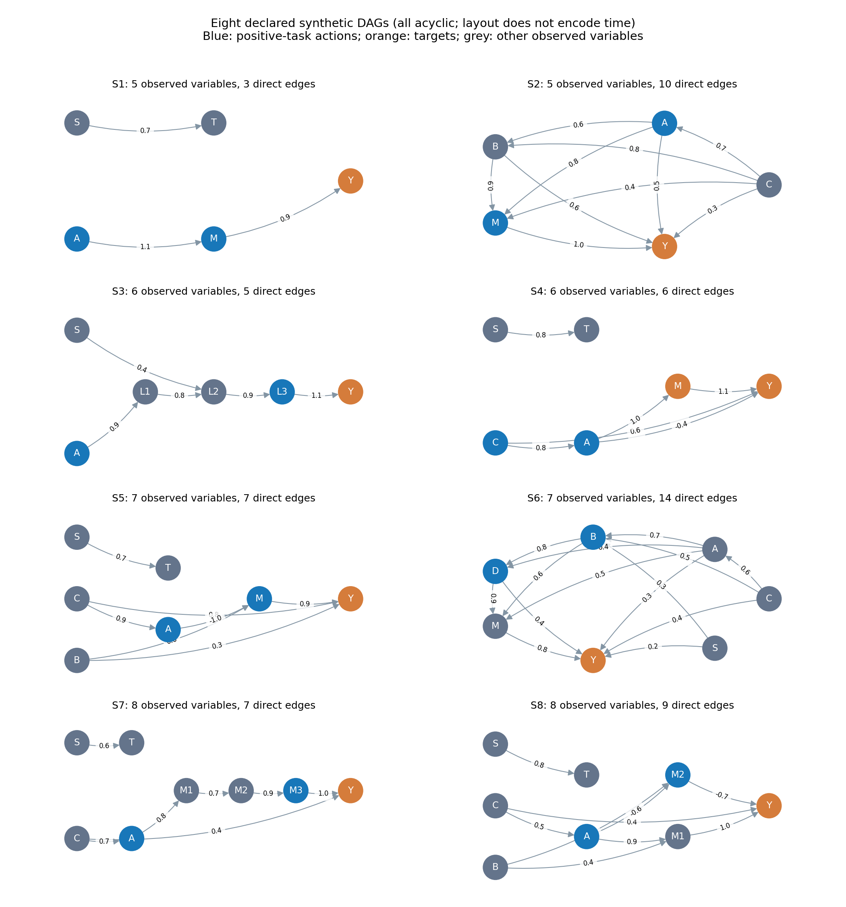

# 다양한 인과구조에서 그래프 품질과 개입 추천 성능 비교

2026-10-24. **8개 선언 구조·48개 독립 학습 데이터·144회 실제 인과발견 학습을 완료했다.** 16개 양성 과제와 1개 음성 대조를 세 정책으로 평가한 918행, 별도 통제 오류 실험 120행 및 실제 do 표본 78,336개를 보존했다. 실패·시간 초과·보조 정책 제한은 0건이다. 결과는 소규모 합성 환경의 탐색이며 제조공정의 복구·안전 검증과 구분한다.

## 1. 연구의 원래 목적

연구 질문은 **“불완전한 인과그래프에서 어떤 구조적 품질 지표가 실제 개입 추천 성능을 가장 잘 설명하는가?”**이다. 인과발견 알고리즘의 F1을 높이는 연구가 아니라, 서로 다른 그래프를 같은 추천기에 넣었을 때 좋은 조작을 고르는 능력과 어떤 구조 지표가 연결되는지 확인하는 연구다. 지표의 연관성·예측력과 지표 자체를 높였을 때의 인과적 개선은 구분한다.

시작 시 PR #12는 OPEN, head `23d19f56cd6510783398cfa95f66f1d1d8194937`, CI는 success였다. 그 위에 `feature/diverse-causal-structures`를 만든 stacked 작업이다. PR #12 및 이번 후속 PR은 승인 없이 병합하지 않았다. 기존 TEP 원자료·7개 frozen graph·Step 6·적합·원시 로그·첫 통합 및 반복 실험·RESEARCH_DESIGN.md는 수정하거나 재생성하지 않았다.

## 2. 지난 반복 실험의 한계와 이번 통제

지난 PR #12는 4변수 한 구조에서 독립 데이터 12개·학습36회·4과제·3정책을 연결했다. 구조 자체가 하나이고 알고리즘의 가정·CPDAG/DAG 표현·미확정 방향 처리·거친 후보값이 함께 달랐다. 이번에는 참조 구조를8개로 늘리고 알고리즘/표본 수/정책을 분리해 기록했다. 일차 정책을 **확정 간선 전용**으로 고정하고, 동치류 minimax와 불일치 보류는 보조로 비교했다.

실행 전 `PLAN_v1.json`을 저장했으며 SHA는 `0d010bf81b6e6e688130ae499c920502e4571e24f6f4b72e64bd19f403c1fb6b`다. 수식·계수·과제·seed·144회 시도·분석 모형과 구조 통째 제외 절차까지 미리 고정했다. 결과를 보고 참조 구조·목표·후보·임계값을 바꾸거나 유리한 반복을 추가하지 않았다.

## 3. 인과구조를 어떻게 다양화했는가

모든 변수는 관측 가능하고, 시간차 없는 선형 가산 DAG다. 외생 오차는 서로 독립인 대칭 Uniform이며 각 표준편차는1이다. 관측하지 못한 공통 원인·순환·시차를 추가하지 않았다. 구조 특성은 서로 배타적 분류가 아니다.

| 구조 | 변수 | 직접 간선 | 핵심 특성 | 양성 과제: 조작→목표, 목표 평균 |
|---|---:|---:|---|---|
| S1 | 5 | 3 | 희소 사슬·독립 주변 가지 | M→Y:0.6 / A→Y:0.8 |
| S2 | 5 | 10 | 조밀·관측 공통 원인·직접/간접 혼합 | M→Y:0.65 / A→Y:1.6 |
| S3 | 6 | 5 | 중간 변수3개를 거치는 긴 경로 | L3→Y:0.8 / A→Y:0.3 |
| S4 | 6 | 6 | 직접/간접 부호 혼합·공통 원인·주변 가지 | A→Y:0.6 / C→M:0.6 |
| S5 | 7 | 7 | 관측 공통 원인·음의 총효과·주변 가지 | M→Y:0.65 / A→Y:0.6 |
| S6 | 7 | 14 | 조밀한 분기·합류·여러 경로 | D→Y:0.9 / B→Y:−0.8 |
| S7 | 8 | 7 | 긴 경로·공통 원인·주변 가지 | M3→Y:−0.65 / A→Y:0.4 |
| S8 | 8 | 9 | 두 매개 경로·부호 혼합·주변 가지 | M2→Y:0.6 / A→Y:1.0 |

S1에 S→Y, 목표0의 음성 대조를 별도로 추가했다. 총17과제이지만 일차 분석에는 양성16과제만 쓴다. 모든 후보는 −1/−0.5/0/0.5/1, 기준 do 값은0, 비용은0.2×조작²이다. 값은 모두 무차원이며 물리적 안전 범위가 아니다. 목표와 비용은 결과 확인 전에 정했다. 선형 식과 거친 격자 때문에 같은 조작으로 묶이는 결과가 생길 수 있다는 사전 경고도 남겼으며 실제 결과를 보고 후보를 촘촘하게 바꾸지 않았다.

그림의 위치는 시간 순서가 아니다. 정확한 모든 계수·식·행렬은 `reference_graphs_v1/`과 계획 파일에 있다. 예를 들어 S4의 A→Y 직접 계수는−0.4지만 A→M→Y는+1.1이어서 총효과는+0.7이다. 직접 간선과 총효과의 부호·도달성을 동일하게 취급하지 않았다. S5의 일부 다른 경로처럼 부호 합산으로 총효과가 작아지는 경우도 그대로 유지했다. 난이도를 변수 수 하나로만 설계하지 않았다.

## 4. 실제 생성환경 검증과 학습 조건

고정 causalAssembly commit은 `8da3729e6383f0e1cbe7740bb6ab7ac4977ac7f9`, 무변경 `models_fcm.py` SHA는 `c1f1b7f6b62c8916ebd23cb0002cdad1e9fcfb995b81cfae9558271987c4290e`다. 기존 격리 환경을 재사용했고 외부 라이브러리의 동작을 수정하지 않았다. 전체 제조 generator를 검증했다는 뜻은 아니다.

S1/S2에서 먼저 소규모 검증을 통과한 뒤 나머지6개를 검증했다. 총8개 관측 조건과34개 do 조건에서 다음을 실제 확인했다.

- 선언 수식의 직접 간선과 원본이 반환한 GT가 정확히 일치한다.
- 원본 sampler의 실제 잡음을 기록해 관측/do의 각 행을 재구성할 수 있다.
- 조작 변수 식만 상수로 바꾸고 부모와 해당 잡음 호출을 제거하며, 다른 식은 보존한다.
- 새 seed는 다른 표본을 만들고, 같은 seed의 새 객체 반복은 exact다.
- 잡음을 관찰하는 hook을 제거한 원래 API 호출과 결과가 exact다.

모든 검증을 마친 후에만 학습을 시작했다. 관측 학습은 256/512개×조건별3반복으로 구조당6개, 전체48개 독립 데이터다. 학습 표본 총18,432개, 별도 seed의 검증 표본 총12,288개를 생성했다. 알고리즘은 실제로 PC-stable/BOSS/DirectLiNGAM을 각각48회 실행했다.

공식 causal-learn0.1.4.8과 lingam1.13.0 및 지난 학습 함수를 재사용했다. PC는 stable/KCI/alpha0.01, BOSS는 고정 BIC 설정, Direct는 pwling·사전 순서 없음·표준화 계수 절댓값0.05 기준을 유지했다. 비정규 오차로 Direct의 해당 가정을 충족하는 환경을 구성했지만 BOSS의 Gaussian BIC가 정확한 Uniform 우도인 것은 아니다. 정규 진단을 섞지 않았다. 모든 변수 순서는 사전에 고정한 비인과적 순열이다.

학습 worker의 설정에는 CSV hash·열 순서·알고리즘/seed/라이브러리 설정만 들어간다. 기준 그래프·수식·계수·과제는 worker에 전달하지 않는다. 모형 적합은 같은 학습 CSV와 train-only 표준화·공통 Ridge alpha 정책을 사용했다. 이 SCM의 alpha 선택은 관측 검증 MSE이며 실제 do 결과를 쓰지 않는다.

## 5. 알고리즘별 구조 정확도

다음 값은 구조마다 독립 데이터6개에서 얻은 평균 연결 F1 / 엄격한 방향 F1이다. 같은 데이터의 세 알고리즘은 상관된 결과다.

| 구조 | PC-stable | BOSS | DirectLiNGAM |
|---|---|---|---|
| S1 | 1.000 / 0.000 | 1.000 / 0.000 | 1.000 / 1.000 |
| S2 | 0.574 / 0.293 | 0.571 / 0.000 | 0.991 / 0.991 |
| S3 | 0.926 / 0.267 | 0.933 / 0.267 | 0.985 / 0.985 |
| S4 | 0.891 / 0.000 | 0.970 / 0.227 | 0.976 / 0.976 |
| S5 | 0.777 / 0.051 | 0.832 / 0.344 | 0.978 / 0.978 |
| S6 | 0.646 / 0.235 | 0.653 / 0.220 | 0.964 / 0.964 |
| S7 | 0.936 / 0.048 | 1.000 / 0.286 | 0.979 / 0.979 |
| S8 | 0.876 / 0.244 | 0.980 / 0.527 | 0.991 / 0.991 |

S1에서는 모든 알고리즘의 연결 F1이1이어도 PC/BOSS는 방향이 미확정이었다. 이는 확정 방향을 요구하는 척도에서 점수가 낮은 상태이며, 모든 방향을 잘못 단정한 상태와 구분해야 한다. Direct가 높은 복원율을 보인 것은 이번의 선형·독립 비정규 오차·전체 변수 관측 조건 안에서의 결과다. 실제 제조 데이터에서의 우월성으로 일반화하지 않는다.

지표 정의는 다음과 같다.

| 지표 | 정의·분모·해석 |
|---|---|
| 연결 F1 | 2×맞는 무방향 쌍/(예측 쌍+참조 간선), 0~1 |
| 엄격한 방향 F1 | 2×맞는 확정 방향/(예측 연결쌍+참조 간선), 미확정도 분모에 유지 |
| 확정 방향 F1/precision | 확정 간선만의 분모로 별도 계산. 확정 간선0개면 precision은 null |
| 경로 복원 | 해당 과제의 모든 참조 방향 경로의 간선 합집합 recall, 완전 경로 비율·전부 복원 여부 |
| 도달성/직접 관계 | 방향 경로 존재와 직접 XY 정답을 분리. 미확정 XY는 null |
| 오류 수 | 누락·추가된 쌍, 역방향, 미확정 비율·간선 수를 각각 기록 |
| 정규화 SHD | (누락+추가+역방향+참조 쌍 미확정)/참조 간선 수. 1 초과 가능 |
| 쌍 정규화 SHD | 같은 오류를 가능한 무방향 쌍 n(n−1)/2로 나눔 |

변수 수·간선 수가 다르면 같은 오류 수의 상대적 의미가 달라진다. 원시 오류와 두 정규화 값을 함께 남겼다. 방향 미확정 간선을 정답 방향으로 완성하지 않았다.

## 6. 구조·과제별 실제 추천 결과

144개 그래프에 세 정책을 적용한918개 추천과 보조 통제 실험120개 추천을 **모두 동결한 뒤** 평가를 생성했다. 같은 구조/조작/값을 고른 모든 그래프·정책은 평가 자료를 공유한다. 17개 고유 Action×(5후보+독립 기준)×3seed×256개=78,336개 do 표본이다. 동일 seed의 행별 잡음 일치를 가정하지 않고 독립 평균·SE·95% 정규근사 구간으로 평가했다.

실제 표본 평균과 목표의 제곱 차이+비용을 목표 손실로 썼다. 개별 표본 제곱오차의 평균과 다르다. 추가 손실은 선택 후보의 평균 손실−동일 격자의 최소 평균 손실이다. 최선 후보도 유한 표본에서 얻은 경험적 기준이며 연속 조작 공간의 참최적값은 아니다. 구조 간 일차 분석에는 이를 사전 과제 scale²로 나눈 값을 사용했다. 추천 후의 최선 후보 비교는 평가용이며 추천값을 바꾸지 않았다.

| 구조 | 직접 관계 중심 과제의 평균 정규화 추가 손실 | 경로 중심 과제의 평균 정규화 추가 손실 |
|---|---:|---:|
| S1 | 0.2529 | 0.3417 |
| S2 | 0.4008 | 0.3096 |
| S3 | 0.2209 | 0.0798 |
| S4 | 0.1097 | 0.1359 |
| S5 | 0.1946 | 0.0833 |
| S6 | 0.3579 | 0.3160 |
| S7 | 0.1034 | 0.1254 |
| S8 | 0.0235 | 0.4002 |

각 셀은 같은 구조·과제의18개 추정 그래프 평균으로, 독립 N=18이 아니다. 알고리즘·표본 수·정책별 상세 행에는 추천값·예측/실제 평균·효과 예측 오차·목표 차이·비용·손실을 모두 저장했다. 수식의 이론 평균은 동결 후 구현 검산에만 썼다.

기존 상대 regret도 보존하되 기준 손실 또는 개선 가능한 간격이 scale²의1%보다 작으면 null로 처리하도록 사전에 정했다. 이번 표본에서는 그 수치 하한을 모두 통과했다. 하지만 이것이 통계적 안정성 보장은 아니다. 음성 대조의 독립 기준 평균은0.1067, 95% 구간은 약[−0.0093,0.2227]이며 수식상의 참평균0을 포함한다. 기준 평균 손실0.01138은 하한0.01을 조금 넘었을 뿐이다. 결과를 본 뒤 하한을 바꾸지 않았고, 일차 분석에서는 음성 대조를 제외하고 기준 분모에 의존하지 않는 scale 정규화를 사용했다. 음성 대조54행은 모두 기준값0을 선택했다.

## 7. 어떤 품질 지표가 성능과 관련됐는가

일차 정책과 양성16과제를 고정해 구조·과제별 탐색 Spearman을 계산했다. 최소 독립 데이터6개와 지표/결과의 두 값 이상 변동이 있는 경우만 계산했고 p-value는 만들지 않았다.

- 방향 F1과 경로 recall은16과제 모두에서 손실과 음의 연관을 보였다.
- 연결 F1은 계산 가능한14과제에서 모두 음의 연관이었지만 S1의 두 과제는 연결F1 자체가 상수라 설명력을 비교할 수 없었다.
- 직접 XY 정확도는6과제에서만 변동이 있었고,5개는 음의 연관·1개는 양의 연관이었다. 모든 과제에서 유효한 단일 지표로 볼 근거가 없다.
- 정규화 SHD와 미확정 비율은16과제에서 높은 값이 큰 손실과 함께 나타났다.

이 결과 중 일부는 **경로가 없으면 기준 조작으로 대체하는 추천 규칙과 기계적으로 연결**된다. 완전한 방향 경로를 가진 모델군과 미확정 CPDAG 모델군의 차이를 새 인과 효과로 부르지 않는다.

같은 알고리즘 내부의 경로 지표를 보면 PC는7개 과제에서 계산 가능했고 모두 음의 연관이었다. BOSS는6개 중5개가 음·1개가 양이었다. Direct는16과제 모두 경로 지표가 상수여서 내부 설명력 비교가 불가능했다. Direct의 손실이 항상0인 것은 아니므로 계수 추정과 유한 평가 표본 등 경로 점수 외의 요인도 남는다. 전체 알고리즘을 섞은 연관이 같은 알고리즘 내부에서도 모두 재현됐다고 주장할 수 없다. 표본 수별 층은 독립 반복이3개뿐이므로 사전6개 데이터 기준을 충족하지 못했다.

## 8. 정책·알고리즘 차이와 지표 중복

동치류 대안은 원래 skeleton·고정 방향·비차폐 충돌·비순환 제약을 보존했다. 최대 미확정12쌍/일관된 DAG128개를 넘으면 제한하도록 고정했으며, 실제 최대 확장은16개여서 제한은 발생하지 않았다. 모든 보조 정책도 실행했다. 후보들은 조건부 독립 동치 제약 안의 가능성이며 각 후보의 비정규 오차 독립성까지 검증한 것은 아니다. minimax 예측 범위는 보장된 신뢰구간이 아니고, 점 예측은 후보 평균이며 사후확률 가중치가 아니다.

같은 그래프·과제에서 기본 정책과 비교하면 minimax는306행 중42행의 조작을 바꾸어42개 손실을 줄였고 이번에는 악화가 없었다. 보류는15행을 바꾸어10개 개선/5개 악화였다. 이 행들도 상관된 반복 결과다. 앞선 PR #12에는 minimax 악화 사례가 있었으며 그 결과를 덮어쓰지 않는다. 이번 결과만으로 minimax가 항상 좋다거나 보류가 안전하다고 주장하지 않는다.

그래프 점수는 정책이 바뀌어도 그대로다. 따라서 같은 점수에서 성능이 바뀐 것은 정책 효과이며, 그래프 품질의 변화로 해석하지 않는다. `NO_PATH_BASELINE_FALLBACK`, `COMPUTED_BASELINE`, `AMBIGUITY_ABSTENTION`도 분리했다.

지표 중복도 컸다. 전체 일차 행의 방향 F1과 경로 recall의 탐색 상관은 약0.901, 방향 F1과 정규화 SHD는−0.978이었다. 두 지표의 독립 기여를 회귀계수만으로 분리하면 위험하다. 훈련 설계행렬112개는 모두 수치적으로 full rank였고 최대 condition number는 약40.31이었다. **수치 계산 가능성이 통계적·인과적 식별을 보장하지 않는다.**

## 9. 새로운 구조를 통째로 제외하면 결과가 유지되는가

8회 leave-one-structure-out 검증을 실제 계산했다. 매번 한 구조의 모든 학습 데이터·알고리즘·과제를 함께 제외했다. 결측 대체·feature 표준화·결과 표준화는 나머지7개 구조에서만 적합하고 구조별 훈련 가중치를 같게 했다. 모형·지표 후보·Ridge alpha0.01은 사전에 고정했으며 평가 구조의 손실을 보고 선택하지 않았다. 음성 대조와 인위적 오류 그래프는 제외했다.

아래는 구조별 MAE를 같은 가중치로 평균한 값이다. 대상은 실제 추천의 scale 정규화 추가 손실이며 낮을수록 작은 예측 오차다. RMSE와 각 구조의 개별 오차도 보존했다.

| 지표/모형 | 지표 단독 macro MAE | 알고리즘·표본 수·변수 수·밀도·미확정 비율 고려 후 MAE |
|---|---:|---:|
| 연결 F1 | 0.174327 | 0.147939 |
| 방향 F1 | 0.147497 | 0.159106 |
| 핵심 경로 recall | 0.133671 | 0.148120 |
| 직접 XY 정확도 | 0.224980 | 0.171320 |
| 정규화 SHD | 0.150388 | 0.160934 |
| 미확정 비율 | 0.165085 | 공변량에 이미 포함, 중복 추가하지 않음 |

훈련 평균만 쓰는 기준은0.229165, 공변량만 쓰는 기준은0.170629, 여러 품질 지표를 함께 넣은 Ridge는0.162698이었다. 경로 지표 단독 모형의 평균 오차가 작았지만, 공변량을 고려하면 연결 F1과 경로의 오차 차이는 약0.00018로 매우 작았다. 이를 우월성이나 독립 설명 효과로 결론내리지 않는다.

구조별 순서도 같지 않았다. 예를 들어 S4를 제외한 검증에서는 연결 지표 단독 MAE가 약0.111, 경로 지표는0.193이었다. 전체 평균만으로 모든 구조에서 경로 지표가 우수하다고 말할 수 없다. 전체 지표를 많이 넣은 모형도 항상 개선되지 않았다.

이 단계는 손으로 설계한8개 구조의 예측 실행 가능성 확인이다. 서로 겹치는7개 훈련 구조를 사용하는8개 fold를 독립 검정 표본으로 세지 않았다. 고정 선형 손실 예측기는 음의 손실도 예측할 수 있으며 실제 최소 예측은 약−0.173이었다. 사후에 값을 잘라 오차를 개선하지 않았다. 향후 비음수 예측 모형을 쓰려면 새 사전 계획에서 비교해야 한다.

## 10. 통제 오류 실험과 확인하지 못한 것

S1/S7에서 같은 관측 데이터와 같은 alpha·기본 추천 정책으로 참조/핵심 간선 제거/주변 간선 제거/핵심 방향 반전/주변→목표 간선 추가를 따로 실행했다. 구조별5개 인위적 변형×6개 데이터=60개 모형, 양성2과제씩120행이다. 실제 알고리즘이 발견한 그래프가 아니며 일차 분석에서 제외했다.

| 구조·과제 | 핵심 간선 제거 평균 목표 손실 | 주변 간선 제거 평균 목표 손실 |
|---|---:|---:|
| S1 직접 | 0.08755 | 0.08755 |
| S1 경로 | 0.67165 | 0.15915 |
| S7 직접 | 0.06822 | 0.06822 |
| S7 경로 | 0.22480 | 0.07696 |

두 제거는 오류 수와 전체 연결/방향 F1이 같지만, 경로 과제의 손실은 달랐다. 직접 과제는 해당 간선 제거의 영향을 받지 않아 같았다. 이는 오류 위치가 과제와 함께 해석돼야 함을 보여주는 제한된 조작 검산이다. 경로 부재 대체 규칙도 작동하므로 F1 자체를 인위적으로 높이면 항상 성능이 개선된다는 일반적 인과 주장은 아니다.

이번에 확인하지 못한 사항은 다음과 같다.

- 8개 손설계 구조 밖의 일반화와 엄밀한 지표 순위·검정력.
- 알고리즘 가정·미확정 표현·경로 규칙·계수 추정 오차의 완전한 분리.
- 실제 제조공정의 모델/제어기 동등성, Fault 복구 시간, Safety, 엄격한 개인 반사실 추론.
- 144개 학습 전체의 별도 replay. API 반복은 실제 실행했고 전체 재학습은 NOT_RUN이다.

실행 시간은 약1001.56초였으며144회 학습·918개 일차/보조 정책 행·120개 통제 행의 실패는0건이다. 원시 식·통계·추천·해시와 구조 단위 holdout을 검증했다. 실제 외부 라이브러리 실행과 CI의 저장 기록 검사는 다르다. 모든 환경·명령·원시 결과·실패/제한 파일은 [재현 안내](../../research_runs/diverse_structure_pilot/README.md)를 따른다.

## 11. 다음 연구 단계와 현재 결론

이번에는 여러 구조에서 방향·경로 품질과 추천 손실의 연관을 관찰했고, 구조 전체를 제외하는 예측 비교를 실제로 구현했다. 그러나 **“가장 잘 설명하는 지표 하나”는 아직 확정하지 않는다.** 경로 지표 단독의 좋은 평균 예측과 공변량 조정 후의 거의 같은 오차, 알고리즘 내부의 변동 부족, 구조별 순서 변화가 함께 존재한다.

다음 우선순위는 다음과 같다.

1. 새 확인용 구조·계수·seed를 결과 확인 전에 고정해 이번8개 구조에 선택된 지표를 독립적으로 평가한다. 현재 outer fold의 결과로 모형을 고른 뒤 같은 fold를 확증 자료라고 재사용하지 않는다.
2. 구조-데이터-과제 계층과 알고리즘/정책을 유지하고, 최소 정밀도·표본 변동·지표 중복을 고려한 확인 분석 계약을 정한다. 144그래프·918행·rollout 수를 독립 구조 수로 늘리지 않는다.
3. 계수 강도/부호·거친 격자·비음수 손실 예측의 민감도는 별도 사전 계획으로 다룬다. 현재 결과를 보고 참조나 후보를 바꿔 같은 실험에 합치지 않는다.

연구 질문은 끝까지 유지한다. 현재 완료 범위는 **다양한 선언 합성 구조에서 실제 학습·추천·do 평가·구조 단위 탐색 비교**이며 제조공정 검증의 완료가 아니다.
