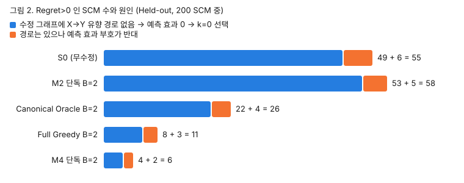
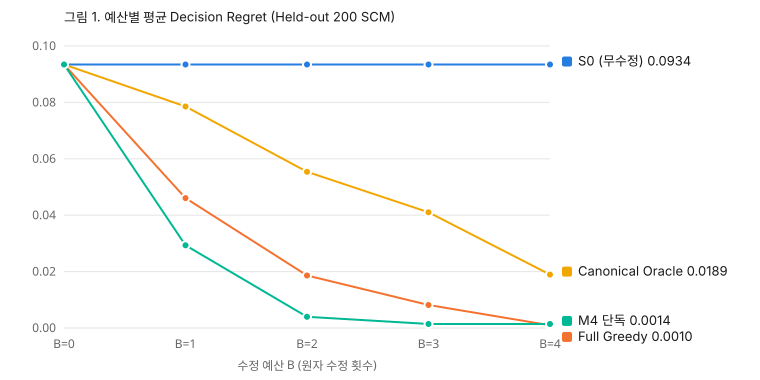
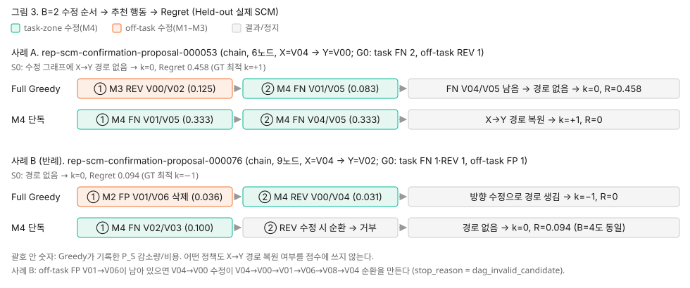

# M1–M4 지표와 수정 정책의 메커니즘 분석 (Research C)

작성: 2026-11-25 · 인수인계 문서 Part 6 정창민 담당 업무 · **사후 탐색 분석(post-hoc exploratory)**
지표 정의 검토는 [M1_M4_METRIC_DEFINITION_REVIEW.md](M1_M4_METRIC_DEFINITION_REVIEW.md)에 따로 있다.

## 1. 핵심 결과

1. **이 설계에서 Regret은 거의 전적으로 "수정된 그래프에 X→Y 유향 경로가 있는가, 있다면 효과 부호가 맞는가"로 결정된다.** 추천 모형의 예측 효과가 0인 경우와 학습용 DAG에 X→Y 경로가 없는 경우가 22,440행 모두에서 일치했다. 경로가 없으면 다섯 행동의 예측 손실이 같아 k=0이 선택된다. GT 최적 행동은 264개 SCM 모두 k=±1이었다. 그래서 Regret>0은 (a) 경로 없음 → k=0, (b) 경로는 있으나 부호 반대, 이 두 경우로만 생겼다. 부호는 맞는데 크기 때문에 손해를 본 경우는 0건이다.
2. **S0의 Regret은 task-zone 오류가 있는 SCM에서만 생긴다.** Held-out에서 task-zone 오류가 있는 103개 SCM의 S0 평균 Regret은 0.181이었고, task 오류가 없는 97개는 모두 0이었다. Regret>0인 S0 55건 중 49건(전체 Regret 합의 87%)이 "경로 없음"이었다.
3. **off-task 수정(M1·M2·M3 단독과 조합)은 학습 그래프를 바꾸지만 행동은 거의 바꾸지 않는다.** Held-out B=2에서 M1은 37개 SCM의 학습 DAG를 바꿨지만 행동 변화는 0건이었다. M2는 86개 SCM의 DAG를 바꾸고 4건에서 행동을 바꿨는데, 3건은 악화되고 1건은 개선됐다. 그래서 M2 평균 Regret은 S0보다 높다(0.1005 vs 0.0934). 악화된 3건은 모두 off-task FP가 우연히 맞는 부호의 X→Y 경로를 만들고 있었는데 그것을 지운 경우다(§5.3).
4. **M4가 Full Greedy보다 나은 6개 Held-out B=2 action-disagreement 사례는 하나의 메커니즘으로 환원되지 않는다.** 원본 Ledger 재검증에서 5개는 초기 X→Y 경로가 없었고 M4가 경로를 복원한 반면 Full Greedy가 k=0을 추천했다. 1개(`…000139`)는 초기와 두 수정 그래프 모두 X→Y 경로가 있었으며, M4와 Full Greedy가 서로 다른 행동 부호를 골랐다. 이 사례의 이득은 경로 생성이 아니라 경로·계수 추정에 따른 행동 방향 차이와 연결된다. Full Greedy가 더 나은 1개(`…000076`)는 off-task FP가 남아 있을 때 task 방향 수정이 DAG 순환을 만들어 M4가 중단된 경우다.
5. **반례도 있다.** Held-out `…000076`에서는 off-task FP가 남아 있으면 task REV를 고칠 때 순환이 생겨, M4가 예산이 남아도 그 수정을 하지 못했다(B=4까지). Full Greedy는 그 FP를 먼저 지워서 이겼다. Held-out B=4 평균은 이 사례 때문에 Full Greedy(0.00096)가 M4(0.00144)보다 낮다.
6. **구조 점수 개선과 Regret 개선은 다르다.** Held-out `…000146`에서는 task REV를 고치자 기존의 (방향이 틀린) X→Y 경로가 끊겨 예측 효과가 0이 됐고, S0보다 나빠졌다. M4, Full Greedy, Canonical Oracle(B=2) 모두 같은 일이 일어났다.

## 2. 데이터와 재현성

**분석 초안은 재생성 ledger에서 시작했고, 2026-11-26 후속 감사에서 승인된 원본 SQLite를 read-only로 재검증했다.** 원본 Development cohort SHA-256은 `dd4264d5085adbabe9510bf99b564ec6c2b33e35d4eeb346a079cc4ccfb9b716`, Held-out은 `37b3c265ecb65b09a97eda91d29411844c3a3851c9fbff6cfa06445f919a3eba`였다. 둘 다 승인 run ID·master seed·manifest 및 저장 audit와 일치했고 SQLite integrity는 `ok`, 완료 SCM 수는 각각 64/200, 저장 결과 payload checksum 오류와 중복 key는 0이었다. 원본 재집계는 Dev 5,440행, Held-out 17,000행 및 각 85 policy×budget cell을 포함했다. 원본의 P1, 평균 Regret, 수정 건수, 행동·그래프 해시와 PR에 남은 표/행동 불일치 사례가 공개된 반올림 정밀도에서 맞았다. PR #40의 재생성 SCM별 전체 원시 결과 DB는 저장되지 않았으므로 모든 SCM-keyed 값의 원본 대 재생성 일치를 주장하지 않는다. 메커니즘 해석은 여전히 Held-out 결과를 본 뒤 수행된 **사후 탐색 분석**이다.

| 항목 | Development | Held-out |
|---|---|---|
| Run ID / master seed | `development-20261123-seed-2026112301-v1` / 2026112301 | `independent-evaluation-20261123-seed-2026112303-v1` / 2026112303 |
| target / cap | 64 / 386 | 200 / 1,104 |
| 실행 환경 | Linux, CPython 3.11.18, 승인 lock 13개 패키지와 같은 버전 | 같음 |
| 문서값과 대조 | S0 0.10085173, FG 0.02564084, M4 0.00292777, P1 delta +0.07521089, 14/1/49, 무오류 G0 7 → **모두 일치** | S0 0.09343898, FG 0.01860262, M4 0.00398775, delta +0.07483636, SD 0.17167541, 45/1/154, 무오류 G0 34, FG 수정 287건(FN 70/FP 82/REV 58/UNRES 77) → **모두 일치** |
| 17×5 평균 Regret 표 | 문서 표와 일치 | 결과 보고서 §6 표와 85칸 모두 일치 |
| Greedy 재실행 대조 | 정책 엔진으로 FG B=1·2 수정 순서를 다시 계산해 64/64 일치 | 200/200 일치 |
| 재생성 DB SHA-256 (cohort) | `63c11e3f…9dc9` | `cfbe51fd…a984` |

DB 파일 해시는 원본과 다르다(타임스탬프 등 실행 메타데이터 차이). 과학적 내용은 위 수치로 대조했다. 원본으로 확정하려면 원본 DB에서 `scripts/mechanism.py`를 read-only로 한 번 돌려 결과 JSON을 비교하면 된다.

## 3. 정책별 수정 유형·비용·Regret (B=2)

각 칸은 SCM 평균 또는 SCM 수다. 수정 건수는 FN/FP/REV/UNRES 순서. "행동 변화"와 "개선/악화"는 같은 SCM의 S0 대비다. 정책×예산 행은 같은 SCM의 반복 측정이므로 독립 표본으로 세지 않았다. 전체 예산은 `tables/*_policy_budget_mechanism.csv`에 있다.

**Held-out (200 SCM)**

| 정책 | 평균 Regret | 평균 비용 | task 수정 FN/FP/REV/UNRES | off-task 수정 FN/FP/REV/UNRES | 행동 변화 | 개선/악화 | 잔여 task 오류 |
|---|---:|---:|---|---|---:|---|---:|
| S0 | .0934 | 0 | – | – | 0 | 0/0 | 0.80 |
| M1 | .0934 | 0.21 | – | 42/0/0/0 | 0 | 0/0 | 0.80 |
| M2 | .1005 | 0.62 | – | 0/124/0/0 | 4 | 1/3 | 0.80 |
| M3 | .0925 | 0.41 | – | 0/0/35/47 | 1 | 1/0 | 0.80 |
| **M4** | **.0040** | 0.70 | 44/14/32/49 | – | 51 | 50/1 | 0.11 |
| M1+M4 | .0059 | 0.88 | 41/13/32/49 | 41/0/0/0 | 50 | 49/1 | 0.13 |
| M3+M4 | .0063 | 1.05 | 42/12/32/46 | 0/0/34/44 | 50 | 49/1 | 0.14 |
| M2+M4 | .0127 | 1.15 | 37/12/31/43 | 0/107/0/0 | 48 | 47/1 | 0.19 |
| M1+M2+M3 | .0945 | 1.00 | – | 39/89/32/39 | 2 | 1/1 | 0.80 |
| **Full Greedy** | **.0186** | 1.44 | 33/9/28/41 | 37/73/30/36 | 46 | 45/1 | 0.25 |
| Canonical Oracle | .0554 | 1.44 | 28/9/23/28 | 43/108/24/24 | 38 | 34/4 | 0.36 |

**Development (64 SCM)에서도 같은 양상이다.** M4 .0029(task 수정 42, off-task 0), Full Greedy .0256(task 32, off-task 61), M1·M2·M3 단독과 조합은 S0와 같은 .1009였다(행동 변화 0). Development에서는 off-task 수정이 행동을 바꾼 SCM이 하나도 없었다.

읽는 법:
- M4가 들어간 조합은 대체로 off-task 지표를 많이 포함할수록 Regret이 높다. 같은 예산에서 task 수정 수가 줄고 잔여 task 오류가 늘기 때문이다(M4 0.11 → Full Greedy 0.25).
- Full Greedy는 M4보다 비용을 2배 썼지만(1.44 vs 0.70), 추가 비용은 거의 off-task 수정이다. M4는 task 후보가 바닥나면 멈춘다(Held-out B=2에서 162/200이 후보 소진으로 정지).
- Canonical Oracle은 같은 비용으로 task 수정을 가장 적게 했다. 고정 순서가 M1→M4라서 off-task가 먼저 처리되기 때문이다.

## 4. 왜 S0에 Regret이 생기는가

추천 모형은 수정된 그래프로 선형 SCM(Ridge α=1)을 적합하고 do(X)의 효과로 행동을 고른다. 학습용 DAG에 X→Y 유향 경로가 없으면(누락, 역방향, UNRES abstention 때문에 끊김) 예측 효과가 0이고 다섯 행동의 예측 손실이 모두 1.0이 되어 k=0이 선택된다. GT 최적은 항상 ±1이므로 이때 Regret이 생긴다.

| Regret>0 SCM 수 (Held-out) | 경로 없음 → k=0 | 부호 반대 | 합 |
|---|---:|---:|---:|
| S0 | 49 | 6 | 55 |
| M2 단독 B=2 | 53 | 5 | 58 |
| Canonical Oracle B=2 | 22 | 4 | 26 |
| Full Greedy B=2 | 8 | 3 | 11 |
| M4 단독 B=2 | 4 | 2 | 6 |

따라서 이 모집단에서 수정의 가치는 대부분 **task zone의 FN·REV·UNRES를 고쳐 X→Y 경로를 복원하는 것**에서 나온다. M4는 정의상 이 오류만 고친다.

## 5. M4와 Full Greedy가 갈린 지점

### 5.1 그래프·행동·Regret 세 층 분리 (Held-out)

| 예산 | 같은 최종 그래프 | 그래프 다름·행동 같음 | 행동 다름 | 행동 다름 중 M4 우세 / FG 우세 |
|---|---:|---:|---:|---|
| B=1 | 106 | 87 | 7 | 7 / 0 |
| B=2 | 83 | 110 | 7 | 6 / 1 |
| B=3 | 80 | 115 | 5 | 4 / 1 |
| B=4 | 80 | 119 | 1 | 0 / 1 |

행동이 달랐는데 Regret이 같은 경우는 없었다. 그래프만 다르고 행동이 같은 110건(B=2)은 대부분 Full Greedy가 off-task 오류를 추가로 고친 경우이고 Regret에는 영향이 없었다. Development는 B=1·2에서 행동 차이가 4건·3건이고 모두 M4 우세, B≥3에서는 0건이었다.

### 5.2 M4 우세 사례의 원본 Ledger 판정

Held-out B=2에서 action이 다른 7개 사례 중 M4는 6개에서 손실이 낮았다. 원본 결과를 다시 읽어 초기·최종 learner DAG의 경로와 action을 분리했다. 5개(`…000041`, `…000053`, `…000125`, `…000140`, `…000158`)는 G0에 경로가 없고 M4만 경로를 복원해 참 최적 부호의 끝점 action을 선택했다. 나머지 M4 우세 사례 `…000139`는 G0, M4, Full Greedy 모두에 경로가 있었다. M4는 `k=+1`(최적 부호), Full Greedy는 `k=−1`을 선택했다. 그러므로 “M4 우세 6건 모두 경로 복원”은 잘못된 요약이다. 서로 다른 행동이 왜 달라졌는지는 수정 로그와 예측 결과로 기술할 수 있지만, 이 post-hoc 표본은 사전 지정된 매개효과 분석이 아니다.

off-task 수정이 먼저 선택된 이유는 대부분 점수가 실제로 높았기 때문이다(정의 검토 §4.1). Held-out B=2 전체에서 수정 가능한 task 후보를 두고 off-task를 고른 단계 46번 중 43번은 점수가 더 높았고, 3번은 동점이라 M1→M4 순서로 결정됐다.

### 5.3 off-task 수정이 행동을 바꾸는 두 경로

로그에서 확인된 off-task 수정의 행동 영향은 두 가지뿐이었다.
- **Rule A의 off-task FP가 X→Y 경로를 만들고 있던 경우.** 이 FP가 마침 맞는 부호의 효과를 주고 있었다면 지울 때 Regret이 커진다(`…000015`, `…000130`, `…000141`: 각각 +0.41, +0.63, +0.55). 틀린 부호였다면 지울 때 줄어든다(`…000149`: −0.19). 즉 M2의 평균 악화는 "가짜 연결을 지워서 손해"라기보다는, task 오류로 끊긴 진짜 경로를 가짜 경로가 우연히 대신하고 있었던 결과다.
- **DAG 제약을 통한 상호작용.** off-task FP가 남아 있으면 task 방향 수정이 순환을 만들어 거부될 수 있다(`…000076`, §6 사례 B).

## 6. 대표 사례 (실제 SCM ID)

| # | SCM | 유형 | 무엇이 일어났나 | 근거 수준 |
|---|---|---|---|---|
| A | `rep-scm-confirmation-proposal-000053-a0052` (Held-out, chain, 6노드, X=V04→Y=V00) | M4 우세 | G0에 task FN 2개(V01/V05, V04/V05)와 off-task REV 1개. FG는 M3 REV(0.125)를 먼저 고친 뒤 FN 하나만 고쳐 경로가 없었다(k=0, R=0.458). M4는 FN 2개를 고쳐 경로를 복원했다(k=+1, R=0). | 로그로 확인 |
| B | `rep-scm-confirmation-proposal-000076-a0075` (Held-out, chain, 9노드, X=V04→Y=V02) | FG 우세 (반례) | M4는 FN V02/V03을 고친 뒤 REV V00/V04 수정이 off-task FP V01→V06 때문에 순환(V04→V00→V01→V06→V08→V04)을 만들어 정지했다(`dag_invalid_candidate`, B=4까지 같음). FG는 FP를 먼저 지운 뒤 REV를 고쳐 R=0. | 로그와 G0 간선으로 확인 |
| C | `rep-scm-confirmation-proposal-000146-a0145` (Held-out, chain, X=V01→Y=V07) | 수정 후 악화 (M4·FG 공통) | G0는 off-task 오류 없이 task 오류 5개. S0는 틀린 그래프에서도 맞는 부호를 예측했다(R=0). REV V01/V06를 고치자 경로가 끊겨 예측 효과 0, k=0, R=0.027. 참 효과가 매우 작은 SCM이다(GT 손실 0.838~0.893). B=4에서도 FN 1개가 남아 회복되지 않았다. | 로그로 확인. 경로가 끊긴 구체 간선은 미확인 |
| D | `rep-scm-confirmation-proposal-000141-a0140` (Held-out, X=V05→Y=V06) | off-task 수정의 악화 | G0에 task FN 1개. Rule A상 off-task인 FP V00–V06(Y에 붙음)이 유일한 X→Y 경로를 만들고 있었다. M2가 이를 지우자 k=−1→0, R 0→0.552. | 로그로 확인 |
| E | `dev-scm-development-proposal-000014-a0013` (Development, X=V06→Y=V01) | 동점 규칙 | FG에서 M3 UNRES와 M4 FN의 점수가 0.0357로 같았고 M1→M4 순서 때문에 M3가 두 번 선택됐다. task FN이 남아 k=0, R=0.590. M4는 FN을 고쳐 R=0. | 로그로 확인 |

## 7. 할 수 있는 말과 할 수 없는 말

**원본 Ledger에서 확인한 것 (사후 분석, 이 두 고정 코호트 안에서)**
- Regret은 학습 DAG의 X→Y 경로 존재·부호로 거의 결정되고, task-zone 수정이 그 경로를 복원해 Regret을 줄였다.
- M4 < Full Greedy (B=1~3)는 Full Greedy가 작은 예산을 off-task에 배분해 task 오류를 남긴 결과로 설명된다. 이는 수정 로그에서 사례별로 확인된다.
- off-task 수정은 대부분 행동과 무관했고, 영향이 있을 때는 우연한 가짜 경로나 DAG 제약을 통해서였다.

**주장할 수 없는 것**
- M4가 일반적으로 우월하다는 것. M4 비교는 Development를 본 뒤 고른 Secondary이고, 이 분석은 Held-out을 본 뒤 한 사후 탐색이다.
- 실제 공정에서도 off-task 오류가 무해하다는 것. 이 결과는 선형 SCM, 5점 action grid(최적이 항상 끝점), X→Y 경로가 없으면 효과 0으로 예측하는 추천 방식에 강하게 의존한다. 효과 크기가 Regret에 반영되는 손실이나 비선형 SCM에서는 다를 수 있다.
- GT DAG를 쓰는 Oracle-assisted 수정이므로, GT 없이 task zone과 오류를 추정해야 하는 현장 정책의 성능은 말할 수 없다.
- 재생성본과 원본의 모든 SCM×정책×예산 값은 대조하지 못했다. 재생성 raw cohort DB가 보존되지 않았고 PR에는 집계표 및 일부 행동 불일치 사례만 있다. 원본 DB의 공식 결과·체크섬·집계는 확인했다.

## 8. 후속 제안

- **matched-opportunity 진단 (가이드라인 후보 C)을 설계할 때** "X→Y 경로 복원 여부"를 중간 결과로 함께 기록하면 구조 → 행동 연결을 바로 볼 수 있다. 이 분석에서 쓴 `scripts/pathcheck.py`가 그 계산이다.
- 후속 기계감사 명령과 provenance는 [`ORIGINAL_LEDGER_MECHANISM_AUDIT.md`](../final_integration/ORIGINAL_LEDGER_MECHANISM_AUDIT.md)에 기록했다.

## 부록: 파일

- `scripts/mechanism.py`: cohort DB를 read-only로 읽어 정책×예산 행을 평탄화
- `scripts/verify.py`: 문서 수치 대조 · `scripts/analyze.py`: 정책 표, M4 vs FG 사례, off-task 영향 · `scripts/ties.py`: Greedy 단계 재실행(점수/동점) · `scripts/flat.py`, `scripts/pathcheck.py`: Regret 원인 분해와 경로 검증 · `scripts/tables_figs.py`, `scripts/fig3.py`: 표와 그림
- `tables/`: 정책×예산 CSV, M4≠FG 행동 사례 CSV, 분석 JSON (dev/ho)
- 과거 재생성 실행 코드는 현재 활성 분석 경로에서 제거했다. 해당 코드는 내부 실행 capability와 확장된 resource profile을 직접 사용해 승인 runner의 config/manifest gate를 거치지 않았다. 기존 commit history와 PR 설명은 이력을 위해 보존하되, 최종 tree에서 실험 실행 진입점으로 제공하지 않는다.
- 공개 `scripts/`는 기존 원본 Ledger를 read-only로 분석하거나 결과표를 출력하는 용도다. 새 cohort를 생성하지 않는다.
